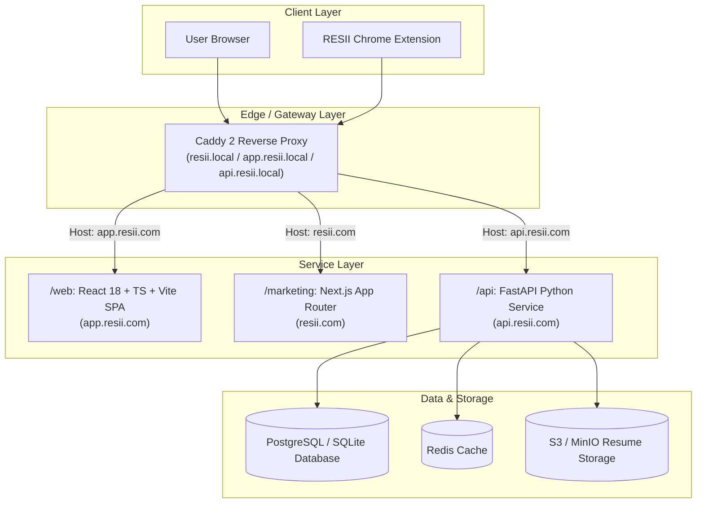

# RESII — AI-Powered Career Platform

RESII is an enterprise-grade AI career platform engineered to help job seekers beat modern ATS (Applicant Tracking System) filtering algorithms through intelligent resume analysis, real-time tree editing, targeted job description tailoring, automated job application pipelines, and gamified progress tracking.

---

## Architecture Overview



---

## Directory Structure

```
├── /web            # React 18 + TypeScript + Vite SPA (Client App)
├── /marketing      # Next.js App Router Marketing Site
├── /api            # FastAPI (Python 3.12) REST API
└── /infra          # Docker Compose, Caddyfile, and environment configs
```

---

## Phase 1 Deliverables Summary

1. **Monorepo Scaffold:**
   - Modular workspaces (`/web`, `/marketing`, `/api`, `/infra`).
   - Root `package.json` with multi-project scripts.

2. **Design System & Tokens (`web/src/styles/tokens.css`):**
   - Palette: Warm architectural canvas (`#f8f6f0`), Deep Spruce emerald (`#0f4c3a`), Indigo accent (`#6366f1`), Lavender (`#c4adff`).
   - Dark theme support via `[data-theme="dark"]`.
   - Sheet shadows, accessible focus rings, and typography hierarchy.

3. **Inline SVG Splash (`#splash`):**
   - Inlined architectural pen-and-sheet SVG animation in `web/index.html`.
   - `<link rel="preconnect">` to the API origin.
   - `<meta name="robots" content="noindex">` to prevent SPA competition with marketing domain SEO.
   - Seamless fadeout once `GET /api/auth/get-session` resolves.

4. **Routing & Code-Splitting:**
   - 15 route-level lazy chunks via React `Suspense` and `React.lazy`.
   - Automatic redirection to marketing / login when unauthenticated on protected routes.
   - Public unauthenticated workflows (`/login`, `/check/:id`, `/check/:id/keep`, `/public/*`).

5. **FastAPI Backend (`/api`):**
   - CORS middleware exposing `ETag`, `Retry-After`, `Server-Timing`, `X-Page-Count`, `X-Left-Out`, `X-Tightened`, `X-Resume-Version`.
   - Cookie-based session auth (`HttpOnly`, `SameSite=Lax`, `Secure`).
   - Seed demo account: **`demo@resii.com`** / **`demo123`** with 1-click instant login button.
   - 100% test pass rate across all auth and public endpoints.

6. **Infrastructure (`/infra`):**
   - `docker-compose.yml` for Caddy, FastAPI, Web SPA, Next.js, PostgreSQL, and Redis.
   - `Caddyfile` for tri-origin local reverse proxy routing.
   - `.env.example` file.

---

## Running the Application Locally

### Option A: Run directly in terminal

1. **Backend (FastAPI):**
   ```bash
   python -m uvicorn api.main:app --reload --port 8100
   ```
   API interactive docs will be available at: [http://localhost:8100/docs](http://localhost:8100/docs)

2. **Frontend SPA (Vite + React):**
   ```bash
   npm --prefix web run dev
   ```
   SPA will run at: [http://localhost:5173](http://localhost:5173)

3. **Marketing Site (Next.js):**
   ```bash
   npm --prefix marketing run dev
   ```
   Marketing site will run at: [http://localhost:3000](http://localhost:3000)

### Option B: Run with Docker Compose

```bash
docker compose -f infra/docker-compose.yml up --build
```
