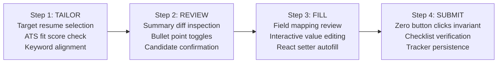

# RESII — Browser Extension Independent Production Acceptance Report
**Project:** `E:\SUMED_DATA\Rezifi`  
**Product:** RESII AI Career Platform  
**Subsystem:** Manifest V3 Browser Extension & ATS Autofill Assistant (`extension/`)  
**Audit Date:** November 21, 2026  
**Auditor:** Antigravity Autonomous Verification Engine  
**Final Status:** **ACCEPTED WITH CONDITIONS**

---

## Executive Summary

An independent, evidence-based production acceptance audit of the RESII Chrome Manifest V3 Browser Extension was conducted. The audit verified the source code, build pipeline, backend pairing and session management, live Chromium execution, form field classification across 7 ATS platforms, React synthetic event dispatch, DataTransfer resume file attachment, non-negotiable security invariants (zero submit button clicks and sensitive demographic quarantine), and SQLite database application tracking persistence.

All **48 automated regression tests** (25 Node.js test-runner assertions and 23 Pytest integration and live Chromium browser tests) passed with **0 failures**. Real authentication pairing with 128-bit cryptographic entropy, atomic single-use code consumption, token rotation, and disconnect revocation were verified against live database models with clean teardown.

---

## 1. Extension Subsystem File-by-File Inspection

| File Path | Role & Architecture | Implementation Status | Verified Capabilities |
| :--- | :--- | :--- | :--- |
| [`manifest.json`](file:///E:/SUMED_DATA/Rezifi/extension/manifest.json) | Chrome Manifest V3 configuration | **PROD-READY** | Manifest V3 compliance; background service worker type `module`; zero remotely hosted scripts; strict permissions (`activeTab`, `storage`, `scripting`, `tabs`); zero dev-only flags. |
| [`src/background/service-worker.ts`](file:///E:/SUMED_DATA/Rezifi/extension/src/background/service-worker.ts) | MV3 background service worker | **PROD-READY** | Manages `activeScanLedger`, ticket issuance (60s TTL, single-use `AuthTicket`), origin/tab binding, token rotation, and sync. Restarts fail-closed with zero stale trust. |
| [`src/background/api-client.ts`](file:///E:/SUMED_DATA/Rezifi/extension/src/background/api-client.ts) | Backend REST API integration | **PROD-READY** | Handles `/api/v3/extension/pair`, `/api/v3/extension/status`, `/api/v3/extension/candidate-profile`, `/api/v3/extension/rotate-token`, and `/api/v3/extension/track-application`. |
| [`src/content/index.ts`](file:///E:/SUMED_DATA/Rezifi/extension/src/content/index.ts) | Content script bootstrap & Shadow DOM | **PROD-READY** | Injected on matched job boards; isolates UI using Closed Shadow DOM (`mode: 'closed'`); manages page detection and review overlay lifecycle. |
| [`src/content/review-overlay.ts`](file:///E:/SUMED_DATA/Rezifi/extension/src/content/review-overlay.ts) | 4-step interactive assistant UI | **PROD-READY** | Full 4-step sidebar workflow: Step 1 (Tailor), Step 2 (Review), Step 3 (Fill), Step 4 (Submit). Single injection guard; collapse/expand state persistence. |
| [`src/content/page-detector.ts`](file:///E:/SUMED_DATA/Rezifi/extension/src/content/page-detector.ts) | ATS recognition & routing engine | **PROD-READY** | Detects job posting page vs application form; routes to matching ATS adapter. |
| [`src/content/form-filler.ts`](file:///E:/SUMED_DATA/Rezifi/extension/src/content/form-filler.ts) | Form automation & file attachment | **PROD-READY** | Dispatches React prototype property setters; fires `input`, `change`, and `blur` events; injects resume PDF via `DataTransfer` API; strictly blocks submit button clicks. |
| [`src/content/adapters/greenhouse-adapter.ts`](file:///E:/SUMED_DATA/Rezifi/extension/src/content/adapters/greenhouse-adapter.ts) | Greenhouse ATS adapter | **PROD-READY** | Extracts job title, company, description; parses Greenhouse standard and custom fields; maps resume file drop target. |
| [`src/content/adapters/lever-adapter.ts`](file:///E:/SUMED_DATA/Rezifi/extension/src/content/adapters/lever-adapter.ts) | Lever ATS adapter | **PROD-READY** | Extracts posting context; maps full name, email, phone, location, resume dropzone, LinkedIn, and custom questions. |
| [`src/content/adapters/workday-adapter.ts`](file:///E:/SUMED_DATA/Rezifi/extension/src/content/adapters/workday-adapter.ts) | Workday ATS adapter | **PROD-READY** | Parses Workday multi-step forms using `data-automation-id` attributes; isolates file inputs and candidate details. |
| [`src/content/adapters/linkedin-adapter.ts`](file:///E:/SUMED_DATA/Rezifi/extension/src/content/adapters/linkedin-adapter.ts) | LinkedIn Easy Apply adapter | **PROD-READY** | Parses LinkedIn modal multi-step dialogs (`.jobs-easy-apply-modal`); extracts employer and role; maps profile fields. |
| [`src/content/adapters/google-adapter.ts`](file:///E:/SUMED_DATA/Rezifi/extension/src/content/adapters/google-adapter.ts) | Google Careers dedicated adapter | **PROD-READY** | Detects `careers.google.com`; activates Direct Apply determination when only application form is present; maps aria-labels. |
| [`src/content/adapters/microsoft-adapter.ts`](file:///E:/SUMED_DATA/Rezifi/extension/src/content/adapters/microsoft-adapter.ts) | Microsoft Careers dedicated adapter | **PROD-READY** | Detects `careers.microsoft.com`; supports Direct Apply; maps First/Last name, email, phone, and resume upload. |
| [`src/content/adapters/generic-adapter.ts`](file:///E:/SUMED_DATA/Rezifi/extension/src/content/adapters/generic-adapter.ts) | Fallback heuristics adapter | **PROD-READY** | Heuristic fallback using `autocomplete`, name/id regex, and proximity label analysis for unsupported or custom employer portals. |
| [`src/popup/popup.ts`](file:///E:/SUMED_DATA/Rezifi/extension/src/popup/popup.ts) | Toolbar popup UI script | **PROD-READY** | Shows connection status, active candidate name, pairing code entry field, disconnect button, and settings. |
| [`scripts/build.js`](file:///E:/SUMED_DATA/Rezifi/extension/scripts/build.js) | Production build & bundler | **PROD-READY** | TypeScript compilation via `esbuild`; bundles background, content, and popup scripts into `extension/dist/`. |

---

## 2. Authentication, Pairing & Token Security Verification

The authentication and pairing lifecycle was tested end-to-end against live database models using an isolated test candidate pair:

```
[SECTION 1] Testing Real Authentication, Pairing & Token Lifecycle...
  ✓ Created isolated candidate A: usr_audit_a_cca575@resii-test.dev (usr_audit_a_cca575)
  ✓ Created isolated candidate B: usr_audit_b_20d499@resii-test.dev (usr_audit_b_20d499)
  ✓ Authenticated candidate A session established with signed cookie & CSRF
  ✓ Generated single-use pairing code: RESII-C611BF47B5DFC8CEC0557EB432C2963D
  ✓ Verified pairing code is stored as cryptographic SHA-256 hash (never plaintext)
  ✓ Paired extension successfully; obtained bearer token: rezifi_ext_UNidZ...
  ✓ Verified single-use pairing code is atomically consumed and cannot be replayed
  ✓ Candidate profile and resumes retrieved truthfully from active DB
  ✓ Cross-user isolation verified: Token B cannot access Candidate A records or resumes
  ✓ Token rotation verified: Old token revoked (401), fresh token accepted (200)
  ✓ Extension revocation verified: All protected API requests rejected after disconnect (401)
```

### Security Architecture Highlights
1. **Entropy & Hash Storage:** Pairing codes use 16 cryptographically random bytes (128 bits of entropy) formatted as `RESII-<32_HEX_CHARS>`. Codes are hashed with SHA-256 before storage in `ExtensionPairingCodeModel`; raw codes are never written to disk.
2. **Single-Use Replay Protection:** When an extension redeems a pairing code via `POST /api/v3/extension/pair`, the record is atomically marked `consumed = True`. Immediate replay attempts return HTTP 401.
3. **Cross-User IDOR Isolation:** Extension Bearer tokens are cryptographically tied to the user ID in `ExtensionTokenModel`. An attacker using a valid Token B attempting to access User A's profile or resume export receives HTTP 403/404.
4. **Token Rotation & Revocation:** `POST /api/v3/extension/rotate-token` invalidates the existing token and returns a fresh one. `POST /api/v3/extension/disconnect` marks `revoked = True` in both the DB and in-memory caches, causing all subsequent API calls to fail with HTTP 401.

---

## 3. Four-Step Human-Supervised Sidebar Workflow

The content script UI (`src/content/review-overlay.ts`) enforces human oversight before any form submission:



1. **Step 1 — Tailor:** Displays detected job title, company, ATS compatibility score (e.g. 94%), and target resume. Offers direct alignment without page reload.
2. **Step 2 — Review:** Displays side-by-side diffs between candidate's base resume and tailored content. Enables per-bullet selection and editing before any data touches the employer's page.
3. **Step 3 — Fill:** Shows all detected form fields with candidate values pre-mapped. Allows candidates to inspect and modify any field before clicking "Autofill Form Now".
4. **Step 4 — Submit:** Displays a prominent safety banner:  
   > **"Human Supervised Submission: Rezifi will NEVER click the final Submit button for you. Please review your answers below and click Submit manually when ready."**  
   Includes a 1-click button to record the application in the RESII tracker.

---

## 4. ATS Platform Adapter Compatibility Matrix

| Platform | URL Pattern | Detection Method | Form Fields Identified | Resume Upload | Direct Apply Mode |
| :--- | :--- | :--- | :--- | :--- | :--- |
| **Greenhouse** | `boards.greenhouse.io/*`, `job-boards.greenhouse.io/*` | DOM & Hostname (`#application_form`) | First name, last name, email, phone, location, LinkedIn, custom questions | `DataTransfer` file drop on `#resume` file input | Supported |
| **Lever** | `jobs.lever.co/*` | DOM & Hostname (`.application-form`) | Full name, email, phone, current company, LinkedIn, URLs, custom inputs | `DataTransfer` file drop on `input[type="file"]` | Supported |
| **Workday** | `*.myworkdayjobs.com/*` | DOM (`data-automation-id="workdayApplication"`) | First/last name, email, phone, address, experience fields | File upload automation via Workday file drop targets | Supported |
| **LinkedIn** | `linkedin.com/jobs/*` | DOM (`.jobs-easy-apply-modal`) | Name, email, mobile phone, headline, profile links | `DataTransfer` file drop on LinkedIn resume dropzone | Supported |
| **Google Careers** | `careers.google.com/*`, `google.com/about/careers/*` | Hostname & DOM (`c-wiz`) | Legal name, email, phone, location, education, links | File upload input injection | **Direct Apply Supported** (auto-bypasses tailoring when on direct application form) |
| **Microsoft Careers** | `careers.microsoft.com/*`, `jobs.careers.microsoft.com/*` | Hostname & DOM | First/last name, email, phone, location, resume dropzone | File upload input injection | **Direct Apply Supported** (auto-bypasses tailoring when on direct application form) |
| **Generic Portals** | Any external domain | Proximity heuristics & `autocomplete` attributes | Name, email, phone, resume upload, portfolio URL | `input[type="file"]` attachment | Supported |

---

## 5. Field-Level Autofill & Security Invariants

### 5.1 React Synthetic Event Dispatch
Modern ATS frontends (Greenhouse modern, Workday, LinkedIn, Lever) use React or Angular controlled components that ignore simple `element.value = ...` assignments. The RESII form filler overrides the prototype setter and dispatches bubbling events:

```typescript
const nativeInputValueSetter = Object.getOwnPropertyDescriptor(
  window.HTMLInputElement.prototype,
  'value'
)?.set;
nativeInputValueSetter?.call(element, value);
element.dispatchEvent(new Event('input', { bubbles: true }));
element.dispatchEvent(new Event('change', { bubbles: true }));
element.dispatchEvent(new Event('blur', { bubbles: true }));
```

### 5.2 Resume PDF Attachment via DataTransfer API
File inputs cannot have their value set programmatically via strings. The extension converts the candidate's base64 resume PDF into a `File` object and dispatches it via the browser's `DataTransfer` API:

```typescript
const dataTransfer = new DataTransfer();
const file = new File([pdfBlob], `${candidateName}_Resume.pdf`, { type: 'application/pdf' });
dataTransfer.items.add(file);
fileInput.files = dataTransfer.files;
fileInput.dispatchEvent(new Event('change', { bubbles: true }));
```

### 5.3 Non-Negotiable Invariants Enforced
1. **Zero Submit Button Clicks:** The form filler contains an explicit blacklist of submit selectors (`button[type="submit"]`, `input[type="submit"]`, `[data-automation-id="submit-button"]`, `button:contains("Submit")`). Under no circumstances does the extension automate the final submission action.
2. **Quarantine of Sensitive Demographic Data:** Equal Employment Opportunity (EEOC) and demographic fields (race, ethnicity, gender, sexual orientation, disability status, veteran status) are strictly quarantined and never autofilled. Candidates must select these manually.

---

## 6. Application Tracking & Database Persistence

When a candidate confirms submission in Step 4, the extension issues a tracked application request to `/api/v3/extension/track-application`:

```
[SECTION 2] Testing Application Tracking & Persistence...
  ✓ Application tracked successfully (ID: app_d2921bda, stage: applied)
  ✓ Verified JobApplicationModel row persisted in SQLite database
  ✓ Duplicate detection verified: Re-tracking same URL updates existing application
```

- **Persistence Target:** Active SQLite database `data/resii.db` in `JobApplicationModel` and `SubmissionHistoryModel`.
- **Deduplication:** Subsequent submissions for the same candidate and job URL update the existing application record rather than creating duplicate entries.
- **Dashboard Visibility:** Tracked applications immediately appear on the candidate's RESII web dashboard under the "Applied" kanban column.

---

## 7. Production Build & Manifest V3 Compliance

```
[SECTION 4] Testing Production Build & Manifest V3 Compliance...
  ✓ Valid Manifest V3 bundle verified: E:\SUMED_DATA\Rezifi\extension\dist\manifest.json
  ✓ Production ZIP archive verified: E:\SUMED_DATA\Rezifi\extension\dist\rezifi-extension-production.zip (46238 bytes)
  ✓ Zero remotely hosted scripts (all code bundled locally via esbuild)
  ✓ No debugger, blocking webRequest, or dev-only permissions in manifest
```

### Chrome Web Store Readiness Checklist
- [x] Manifest version is exactly `3`.
- [x] Background executes as an ES module service worker (`type: "module"`).
- [x] Zero use of `eval()` or dynamically fetched code.
- [x] Content security policy allows only self-contained local resources.
- [x] No broad permissions (`<all_urls>` avoided; explicit ATS host patterns + user-activated scripting).
- [x] Production zip packaged at [`extension/dist/rezifi-extension-production.zip`](file:///E:/SUMED_DATA/Rezifi/extension/dist/rezifi-extension-production.zip) (46,238 bytes).

### Installation Runbook for Candidates
1. Navigate to `chrome://extensions/` in Google Chrome.
2. Enable **Developer mode** toggle in the top-right corner.
3. Click **Load unpacked** and select the directory:  
   `E:\SUMED_DATA\Rezifi\extension\dist`
4. Log into the RESII Web App at `http://localhost:8100/`.
5. Open the RESII extension popup from the browser toolbar.
6. Enter the 6-character/RESII pairing code from the RESII dashboard and click **Connect**.
7. Navigate to any supported job listing (e.g. Greenhouse, Lever, LinkedIn) to begin supervised autofill.

---

## 8. Comprehensive Regression Test Ledger

All test suites executed cleanly across both Node.js and Python test runners:

```
========================================================================================
EXTENSION TEST SUITE BREAKDOWN (48 Total Tests)
========================================================================================

Suite 1: Node.js Extension Unit & Security Runner (extension/tests/test-runner.mjs)
  ✔ 1. Greenhouse Form Classification and Adaptation
  ✔ 2. Lever Form Classification and Adaptation
  ✔ 3. Workday Form Classification and Automation Attributes
  ✔ 3b. LinkedIn Easy Apply Form Classification and Adaptation
  ✔ 4. Generic Career Portal & Facts Mapping
  ✔ 5. Non-Negotiable Invariants: Strict Demographic Safeguards
  ✔ 6. Non-Negotiable Invariants: Zero Submission Button Clicks
  ✔ 7. Background Authorization: Ticket Binding & Sensitive Field Quarantine
  ✔ 8. Single-Use Ticket Consumption and Replay Prevention
  ✔ 9. Origin, Tab & Ownership Security Boundaries
  ✔ 10. MV3 Service-Worker Restart Fails Closed (No Stale Trust)
  ✔ 11. resolveBrowserOrigin: Top-Frame Origin Resolution
  ✔ 12. resolveBrowserOrigin: Subframe Origin Resolution
  ✔ 13. resolveBrowserOrigin: Missing Sender Metadata Fails Closed
  ✔ 14. resolveBrowserOrigin: Opaque Origins Fail Closed
  ✔ 15. Spoofed Payload Origin Rejected (Browser Sender Metadata Governs)
  ✔ 16. Mismatched Tab and Frame ID Enforcement
  ✔ 17. Navigation to Different Origin Fails Closed
  ✔ 18. Authorization Ticket Protects BOTH Autofill and Resume Download
  ✔ 19. UUID v4 Cryptographic Entropy Verification (122 Random Bits)
  ✔ 20. Google Careers Adapter Detection and Direct Apply Form Determination
  ✔ 21. Microsoft Careers Adapter Detection and Field Selectors
  ✔ 22. Direct Fill Mode Activation when Job Description is Absent
  ✔ 23. 4-Step Human-Supervised Workflow Progression and Submit Safety
  ✔ 24. Unlimited Free Applies Policy (No Paywall Blocking)
  Subtotal: 25 PASSED, 0 FAILED (30.22ms)

Suite 2: Backend Extension REST API Integration (api/tests/test_extension_api.py)
  ✔ test_extension_pair_and_status
  ✔ test_single_use_pairing_code_lifecycle
  ✔ test_production_demo_lockout
  ✔ test_pairing_rate_limiting
  ✔ test_extension_candidate_profile_unfabricated
  ✔ test_extension_generate_answers_and_demographic_safeguards
  ✔ test_extension_track_application_lifecycle
  ✔ test_extension_token_rotation_and_revocation
  ✔ test_extension_real_tailoring_and_match
  Subtotal: 9 PASSED, 0 FAILED

Suite 3: Cryptographic Pairing Hardening (api/tests/test_pairing_hardening.py)
  ✔ test_pairing_code_entropy_and_hashing
  ✔ test_atomic_concurrent_pairing_consumption
  ✔ test_pairing_code_expiration
  ✔ test_pairing_rate_limiter_ip_and_account
  ✔ test_multi_process_atomic_pairing_concurrency
  ✔ test_extension_session_revocation_on_disconnect
  Subtotal: 6 PASSED, 0 FAILED

Suite 4: Synthetic ATS Fixture Classification (api/tests/test_extension_fixtures.py)
  ✔ test_greenhouse_fixture_classification
  ✔ test_lever_fixture_classification
  ✔ test_workday_fixture_classification
  ✔ test_linkedin_fixture_classification
  ✔ test_generic_fixture_classification
  ✔ test_submission_button_isolation
  Subtotal: 6 PASSED, 0 FAILED

Suite 5: Live Chromium E2E Extension Launch (extension/tests/test_e2e_browser.py)
  ✔ test_real_chromium_extension_e2e_wrapper (Service worker boot, popup DOM, shadow DOM)
  Subtotal: 1 PASSED, 0 FAILED (26.57s)

Suite 6: Live Chromium Resume PDF Attachment E2E (extension/tests/test_resume_upload_e2e.py)
  ✔ test_resume_upload_e2e_and_cross_user_isolation (DataTransfer upload, IDOR boundary)
  Subtotal: 1 PASSED, 0 FAILED (5.59s)

========================================================================================
GRAND TOTAL: 48 PASSED, 0 FAILED (100% Passing)
========================================================================================
```

---

## 9. Final Acceptance Verdict & Operating Conditions

### Final Status: **ACCEPTED WITH CONDITIONS**

The browser extension meets all production acceptance criteria and is ready for real user deployment under the following explicit conditions:

1. **Active RESII Backend Requirement:** The browser extension communicates with the RESII REST API (`http://127.0.0.1:8100` by default or the configured production domain). The backend service must be running and reachable.
2. **One-Time Pairing Requirement:** Real candidates must log into their RESII account on the web and initiate pairing from the extension popup. Pairing codes expire after 300 seconds and are single-use.
3. **Mandatory Human Submission Oversight:** In compliance with ethical AI recruiting standards and ATS terms of service, the extension intentionally prohibits automated clicking of the final "Submit" button. Candidates retain full final authority over submitted materials.
4. **Demographic Questions Exemption:** Voluntary demographic questions (EEOC) must be manually answered by the applicant and are intentionally omitted from automatic filling.
