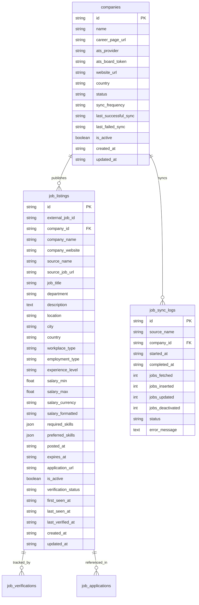

# RESII — PHASE 2: REAL JOB DISCOVERY & INTELLIGENCE ENGINE
## Architecture Audit & Implementation Blueprint

**Document ID:** `docs/PHASE_2_JOB_DISCOVERY_ARCHITECTURE_AUDIT.md`  
**Date:** 2026-11-21  
**Project:** `E:\SUMED_DATA\Rezifi`  
**Product:** RESII AI Career Platform  
**Target:** Production-grade Real Job Discovery, Ingestion, Normalization, Verification & AI Match Engine  
**Execution Mode:** Stage 0 Architecture Audit & Comprehensive Implementation Blueprint  

---

## 1. Executive Summary

This audit establishes the architectural baseline, deficiencies, and engineering blueprint for transitioning RESII from a static, 5-job demo feed to an enterprise-grade, multi-source job discovery engine. The objective is to reproduce the functionality and user experience of Rezifi (genuine vacancies, multi-ATS discovery, India-first coverage, faceted search, verified application links, and resume-grounded AI matching) using RESII's own independent data infrastructure.

The system will connect directly to official public ATS job board APIs (Greenhouse, Lever, Ashby), licensed aggregators (Adzuna), and direct tech employer feeds. It introduces persistent database schemas for companies, vacancies, sync runs, and verification lifecycle tracking, accompanied by resilient ingestion connectors with exponential backoff and rate limiting.

Crucially, this architecture adheres strictly to RESII's zero-fabrication policy: if an external source is unavailable, the system reports genuine provider status or empty results—it never synthesizes fake listings or substitutes obsolete demo data.

---

## 2. Existing Implementation & State Inventory

### 2.1 Frontend (`web/src/pages/JobsFeedPage.tsx`, `App.tsx`, `JobTrackerPage.tsx`)
1. **Feed Page:** `JobsFeedPage.tsx` currently performs client-side queries against `/api/jobs/feed` using query parameters (`query`, `remote_only`, `sort_by`).
2. **Hardcoded Indicators:** Renders a dummy ranking status (`setTimeout` to 1200ms simulating vector alignment).
3. **Missing Features:**
   * Lacks pagination controls (all returned items are displayed on one page).
   * Lacks faceted filtering by experience level (`internship`, `fresher`, `0-2 yrs`, `senior`), employment type (`full-time`, `contract`), country (`India`, `Global`), and city.
   * Lacks dedicated Job Detail view/route (`/jobs/:id`).
   * "Tailor" CTA links to `/tailor` without passing the targeted job description or role metadata.
   * Lacks structured loading skeletons, error boundaries, and empty state CTA flows.

### 2.2 Backend API (`api/jobs.py`)
1. **Static In-Memory Store:** `JOBS_FEED_DB` contains 5 static mock jobs (Stripe, Datadog, Linear, Retool, Anthropic).
2. **Linear Filtering:** Searches with case-insensitive `in` checks on `title`, `skills`, and `description` within Python memory.
3. **Database Absence:** No SQLAlchemy models or SQLite tables currently store job postings.
4. **Existing Endpoints:**
   * `GET /api/jobs/feed` — Returns `JOBS_FEED_DB` filtered by query params.
   * `GET /api/jobs/rank-status/{job_id}` — Returns static 85-94% match percentage.
   * `GET /api/jobs/applications` — Queries real SQLite `job_applications` table.
   * `POST /api/jobs/applications` — Inserts application records to SQLite.
   * `PATCH /api/jobs/applications/{id}` — Updates Kanban stage in SQLite.
   * `DELETE /api/jobs/applications/{id}` — Removes application from SQLite.
   * `GET /api/jobs/saved-searches` — Queries real SQLite `saved_searches` table.
   * `POST /api/jobs/saved-searches` — Persists user search filters to SQLite.

### 2.3 Database & ORM (`api/models.py`, `api/db.py`)
* SQLAlchemy 2.0 declarative models.
* Database engine connects to SQLite `data/resii.db` in development (with WAL mode, busy timeout 5000ms, and foreign keys enabled) and is structured for PostgreSQL portability.
* `init_db()` invokes `Base.metadata.create_all(bind=target_engine)` idempotently on startup.
* No existing models for:
  * Company Registry (`companies`).
  * Job Postings (`job_listings`).
  * Ingestion Synchronization History (`job_sync_logs`).
  * Verification Lifecycle Tracking (`job_verifications`).

### 2.4 Existing Phase 2 AI Integration (`api/ai/`)
* **`evidence.py`:** Generates verified `CandidateEvidenceLedger` containing claims from candidate resume.
* **`job_analyzer.py`:** Parses raw descriptions into structured `JobDescriptionAnalysis` (required skills, preferred skills, seniority, work mode).
* **`matcher.py`:** Calculates deterministic evidence-grounded alignment without hallucinating unevidenced skills.
* **Strict Boundary:** The job discovery engine will output clean, normalized job descriptions and skill arrays directly compatible with `JobDescriptionAnalysis`, ensuring zero interference with existing AI provider routing (`freeflow`, `ollama`, `gemini`, `mock`).

---

## 3. Files Requiring Modification & Creation

| File | Status | Planned Modifications |
| :--- | :--- | :--- |
| `api/models.py` | Modify | Add `CompanyRegistryModel`, `JobListingModel`, `JobSyncLogModel`, `JobVerificationLogModel`. |
| `api/db.py` | Modify | Import new models; add seed helper for curated employer registry. |
| `api/config.py` | Modify | Add job provider environment keys (`ADZUNA_APP_ID`, `ADZUNA_APP_KEY`, etc.). |
| `api/jobs_engine/__init__.py` | New Module | Initialize job discovery and ingestion subsystem. |
| `api/jobs_engine/normalizer.py`| New Module | HTML stripping, skill extraction, currency standardization, work mode classification. |
| `api/jobs_engine/connectors/base.py` | New Module | Base abstract connector (`fetch_jobs`, `normalize_job`, `health`). |
| `api/jobs_engine/connectors/greenhouse.py` | New Module | Official Greenhouse Job Board API connector. |
| `api/jobs_engine/connectors/lever.py` | New Module | Official Lever Postings API connector. |
| `api/jobs_engine/connectors/ashby.py` | New Module | Official Ashby Job Board API connector. |
| `api/jobs_engine/connectors/adzuna.py` | New Module | Adzuna licensed aggregator connector (India & Global). |
| `api/jobs_engine/registry.py` | New Module | Employer source management, ATS identification, seed loader. |
| `api/jobs_engine/service.py` | New Module | Ingestion orchestrator, deduplication, lifecycle verification, error tracking. |
| `api/jobs_engine/scheduler.py` | New Module | Background synchronization runner and task coordinator. |
| `api/jobs.py` | Modify | Replace static `JOBS_FEED_DB` with database-backed query engine, pagination, facet counts, job detail endpoint, and AI match ranking. |
| `web/src/pages/JobsFeedPage.tsx` | Modify | Complete Rezifi-style UI: Faceted filter sidebar, India/Remote toggles, pagination, job detail modal, verified tags, match score badge. |
| `api/tests/test_jobs_real.py` | New File | Test suite for connectors, normalization, deduplication, search filtering, and verification. |

---

## 4. Proposed Database Architecture

### Unique Constraints & Indexing Strategy:
1. `UNIQUE(source_name, external_job_id)`: Prevents duplicate ingestion from the same provider.
2. `INDEX(is_active, posted_at)`: Optimizes newest-first active job listing queries.
3. `INDEX(country, workplace_type, experience_level)`: Accelerates faceted filter queries.
4. `INDEX(company_name, job_title)`: Fast deduplication check across multi-posted sources.

---

## 5. Provider Integration Strategy

### 5.1 ATS Integrations (First-Party Curated Sources)
* **Greenhouse (`boards-api.greenhouse.io/v1/boards/{board_token}/jobs?content=true`):**
  * Fully supported official public endpoint.
  * Ingests full HTML description, department, offices, and application URL.
  * Direct employer link preserved for genuine applications.
* **Lever (`api.lever.co/v0/postings/{company}?mode=json`):**
  * Fully supported official public endpoint.
  * Ingests categories (team, commitment, location), job description, and application URL.
* **Ashby (`api.ashbyhq.com/posting-api/job-board/{board_token}`):**
  * Supported public postings interface.
  * Ingests job title, location, compensation tier (when published), and direct application URLs.

### 5.2 Licensed Aggregator (India-First & Global Tech Roles)
* **Adzuna API (`api.adzuna.com/v1/api/jobs/in/search/1`):**
  * Explicit API licensing terms.
  * India endpoint (`in`) supports Bengaluru, Hyderabad, Pune, Mumbai, Delhi NCR, and Remote India.
  * Provides structured salary min/max, company, location, and canonical redirect URLs.
  * Strict compliance: Prominently renders "Powered by Adzuna" badge and preserves canonical source links.

### 5.3 Workday CXS Boundaries
* Automated reverse-engineering of Workday CXS endpoints without enterprise authorization is prohibited due to Akamai Bot Manager and Workday Terms of Use. Workday positions will only be ingested through licensed aggregator feeds (Adzuna) to ensure full legal compliance.

---

## 6. Security, Legality & Data Quality Rules

1. **No Scraping Violations:** Only access official, public, documented APIs and licensed aggregators. Respect `robots.txt` and rate limits.
2. **Zero Fabrication:** Never generate fake vacancies, synthetic compensation figures, or mock company postings. If sync fails, show authentic error state.
3. **No Direct Application Bypasses:** The "Apply" button opens the genuine, original employer career page. Applications are not simulated or fabricated.
4. **Credential Isolation:** API keys reside in server-side environment variables loaded through `api/config.py` and are never exposed to frontend bundles or client logs.
5. **Deduplication:** Composite indexing prevents duplicate cards when positions are cross-listed.

---

## 7. Migration Plan

1. **Non-Destructive Database Updates:**
   * Run table creations through `Base.metadata.create_all()` in `api/db.py`.
   * Existing `users`, `resumes`, `job_applications`, `saved_searches`, and `tailor_reviews` tables remain completely untouched.
2. **Backward Compatibility:**
   * Existing `JobApplicationModel.job_id` references remain valid. When users track real jobs, the external ID or generated persistent ID is linked.
3. **Rollback Strategy:**
   * If ingestion encounters an unhandled exception, transactions roll back cleanly without partial writes.

---

## 8. Comprehensive Testing Plan

1. **Connector Unit Tests:**
   * Test `GreenhouseConnector`, `LeverConnector`, `AshbyConnector`, and `AdzunaConnector` with mocked JSON responses verifying normalization into `JobListingModel`.
2. **Deduplication & Idempotency Tests:**
   * Ingesting identical batches multiple times must result in zero duplicate database rows and correctly update `last_seen_at`.
3. **Verification Lifecycle Tests:**
   * Verify that jobs omitted across sync cycles transition gracefully to `is_active = False` without deleting historical tracker references.
4. **Search & Filter Query Tests:**
   * Validate SQL query compilation for search queries, experience filters, remote toggles, and pagination offsets.
5. **AI Resume Matching Tests:**
   * Verify match percentage calculation against the candidate's active primary resume evidence ledger.
6. **Frontend E2E Build Validation:**
   * Ensure TypeScript compilation, clean Vite bundle build, and responsive UI components.

---

**Audit Completed.** Proceeding to Step 1: Employer Source Registry & Provider Models.
