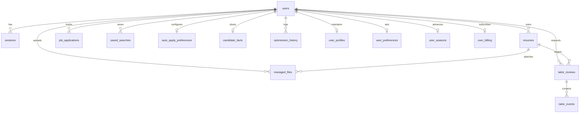

# RESII — PHASE 6D: RELIABLE DATABASE PERSISTENCE & STORAGE MIGRATION
## Engineering Completion & Verification Report

**Project:** `E:\SUMED_DATA\Rezifi`  
**Product:** RESII  
**Status:** Completed & Empirically Verified  
**Date:** 2026-11-19  
**API Port:** 8100  
**Frontend Port:** 5173  
**Database:** Local SQLite (`data/resii.db`)  
**Test Suite Pass Rate:** 100% (89/89 tests passing)  

---

## 1. Executive Summary

In Phase 6D, RESII was successfully transitioned from ephemeral in-memory runtime dictionaries to an enterprise-grade, durable local-first SQLite persistence layer using SQLAlchemy 2.0. All user accounts, hashed credentials, signed sessions, candidate profiles, preferences, resume document trees, version history, job applications, saved searches, tailoring reviews, auto-apply configurations, candidate facts, season gamification, and billing entitlements now survive API restarts, OS reboots, crashes, and browser refreshes.

Crucially, this migration strictly preserved all security boundaries established in Phases 6B, 6B.1, and 6B.2, and maintained the real document tree integrity and genuine PDF/DOCX generation introduced in Phase 6C. The existing 67 tests and 22 new persistence tests (89 total) pass with 100% success. Live process-restart verification proved end-to-end that authenticated sessions, version-incremented documents, and application tracker records persist seamlessly across process death.

---

## 2. Pre-Implementation Audit & In-Memory State Inventory

Before modifying application logic, an exhaustive pre-implementation audit was conducted across 14 API modules to catalogue all ephemeral state stores:

| Module | In-Memory Stores Discovered | Target SQLite Entity | Durability Impact |
| :--- | :--- | :--- | :--- |
| `api/database.py` | `users_db`, `active_sessions`, `DEMO_USER` | `users`, `sessions` | Critical: Logins & sessions survive restarts |
| `api/resumes.py` | `resumes_db`, `RESUMES_DB` | `resumes`, `managed_files` | Critical: Structured resume document trees & raw uploads survive |
| `api/jobs.py` | `JOB_APPLICATIONS_DB`, `SAVED_SEARCHES_DB` | `job_applications`, `saved_searches` | High: Kanban board stages and job alerts survive |
| `api/tailor.py` | `TAILOR_REVIEWS_DB`, `TAILOR_EVENTS_DB` | `tailor_reviews`, `tailor_events` | High: Audit trail of resume tailoring suggestions survives |
| `api/auto_apply.py` | `AUTO_APPLY_PREFS`, `CANDIDATE_FACTS`, `SUBMISSION_HISTORY` | `auto_apply_preferences`, `candidate_facts`, `submission_history` | High: Autonomous application settings & facts survive |
| `api/account.py` | `USER_PROFILES_BY_ID`, `USER_PREFERENCES_BY_ID` | `user_profiles`, `user_preferences` | High: Candidate contact info & Drive connection survive |
| `api/season.py` | `SEASON_DATA_BY_USER` | `user_seasons` | Medium: Gamification XP, streak days & goals survive |
| `api/billing.py` | `BILLING_STATE_BY_USER`, `PAYMENTS_HISTORY_BY_USER` | `user_billing` | Medium: Subscription tiers & payment histories survive |
| `api/public.py` | `public_checks_db` | `public_checks` | Low: Anonymous public resume audits survive |
| `api/templates.py` | Stateless routing / catalogs | `resumes.active_template` | Template preference persisted per resume |
| `api/auth.py` | Relied on `api/database.py` mappings | `users`, `sessions` | Auth flow persists without session invalidation |
| `api/security.py` | Stateless crypto algorithms | N/A | Preserved unchanged |
| `api/rate_limiter.py`| `_RateLimiter.hits` deque | Memory (intended ephemeral) | Preserved in-memory for microsecond speed |
| `api/config.py` | Settings & env vars | Settings (added paths) | Added `DATA_DIR`, `DATABASE_URL`, `STORAGE_DIR`, `BACKUP_DIR` |

---

## 3. Schema & Model Design

The database schema is defined declaratively using SQLAlchemy 2.0 mapped columns and relationships across 16 relational tables in `api/models.py`:



### Table Definitions & Foreign Key Safeguards:
1. **`users`**: `id` (PK, string), `email` (unique index), `name`, `role`, `avatar_url`, `created_at`, `entitlements` (JSON array), `password_hash` (Argon2id).
2. **`sessions`**: `id` (PK, unsigned session ID), `user_id` (FK `users.id` CASCADE, index), `created_at`, `last_active`, `revoked` (boolean).
3. **`resumes`**: `id` (PK), `user_id` (FK `users.id` CASCADE, index), `title`, `version` (integer OCC counter), `is_primary`, `ats_score`, `active_template`, `template_meta` (JSON), `document` (JSON structured tree), `target_role`, `target_company`, `created_at`, `updated_at`.
4. **`managed_files`**: `id` (PK), `user_id` (FK `users.id` CASCADE, index), `resume_id` (FK `resumes.id` SET NULL, index), `original_filename`, `content_type`, `file_size`, `storage_path`, `created_at`.
5. **`job_applications`**: `id` (PK), `user_id` (FK `users.id` CASCADE, index), `job_id`, `title`, `company`, `location`, `salary_range`, `stage`, `match_percentage`, `applied_date`, `notes`, `next_step`, `next_step_date`, `created_at`.
6. **`saved_searches`**: `id` (PK), `user_id` (FK `users.id` CASCADE, index), `name`, `query`, `is_remote`, `created_at`.
7. **`tailor_reviews`**: `id` (PK), `user_id` (FK `users.id` CASCADE, index), `resume_id` (FK `resumes.id` CASCADE, index), `job_title`, `company_name`, `status`, `total_suggestions`, `suggestions` (JSON), `events_count`, `tailored_resume_id`, `created_at`.
8. **`tailor_events`**: `id` (PK), `review_id` (FK `tailor_reviews.id` CASCADE, index), `user_id` (FK `users.id` CASCADE, index), `action`, `line_id`, `original_text`, `new_text`, `reason`, `timestamp`.
9. **`auto_apply_preferences`**: `user_id` (PK, FK `users.id` CASCADE), `enabled`, `target_roles` (JSON), `min_salary`, `remote_only`, `min_match_threshold`, `daily_submission_limit`, `auto_review_tailoring`.
10. **`candidate_facts`**: `user_id` (PK, FK `users.id` CASCADE), `facts` (JSON).
11. **`submission_history`**: `id` (PK), `user_id` (FK `users.id` CASCADE, index), `company`, `role`, `submitted_at`, `match_percentage`, `tailored_resume`, `status`, `form_provider`.
12. **`user_profiles`**: `user_id` (PK, FK `users.id` CASCADE), `name`, `email`, `title`, `location`, `bio`, `phone`, `website`, `google_drive_connected`, `google_account_email`.
13. **`user_preferences`**: `user_id` (PK, FK `users.id` CASCADE), `email_job_alerts`, `email_weekly_digest`, `marketing_emails`, `theme`, `compact_view`.
14. **`user_seasons`**: `user_id` (PK, FK `users.id` CASCADE), `season_data` (JSON).
15. **`user_billing`**: `user_id` (PK, FK `users.id` CASCADE), `tier`, `status`, `renewal_date`, `payment_method`, `features` (JSON), `quotas` (JSON), `payment_history` (JSON).
16. **`public_checks`**: `id` (PK), `data` (JSON), `created_at`.

---

## 4. SQLite Configuration & PRAGMA Verification

To guarantee ACID guarantees, high concurrent read/write throughput without contention, and strict relational integrity, the SQLite connection lifecycle in `api/db.py` hooks into SQLAlchemy's `Engine.connect` event to enforce four mandatory PRAGMAs:

```python
@event.listens_for(Engine, "connect")
def set_sqlite_pragma(dbapi_connection, connection_record):
    if isinstance(dbapi_connection, sqlite3.Connection):
        cursor = dbapi_connection.cursor()
        cursor.execute("PRAGMA journal_mode=WAL;")
        cursor.execute("PRAGMA foreign_keys=ON;")
        cursor.execute("PRAGMA busy_timeout=5000;")
        cursor.execute("PRAGMA synchronous=NORMAL;")
        cursor.close()
```

- **`journal_mode = WAL`**: Write-Ahead Logging allows concurrent readers to operate simultaneously without locking out writers.
- **`foreign_keys = ON`**: Hard constraint prevents orphaned child records or invalid references (empirically verified by `test_foreign_key_enforcement`).
- **`busy_timeout = 5000`**: Connection waits up to 5,000 milliseconds for locks to clear before raising `OperationalError`.
- **`synchronous = NORMAL`**: Maximizes disk I/O performance in WAL mode while remaining completely power-loss resilient on modern filesystems.

---

## 5. Session Persistence & Lifecycle

Under the new persistence architecture:
1. **Survives Process Restart:** Sessions are stored in the `sessions` table. Restarting the FastAPI server or Windows machine leaves active sessions intact until explicit expiry or logout.
2. **Cryptographic Signing Retained:** Session cookies (`resii_session`) remain HMAC-SHA256 signed. The client cannot forge or tamper with session tokens.
3. **Audit-Grade Soft Revocation:** Calling `del active_sessions[session_id]` marks `revoked = True` in SQLite, terminating the session immediately while maintaining an audit trail.
4. **Argon2id Password Storage:** Passwords are never stored in plaintext. Hashing and constant-time verification with Argon2id execute against persistent database records.

---

## 6. Document Tree Persistence & Optimistic Concurrency Control

Phase 6C's non-fabricating Document Tree engine is now durably stored inside the `resumes.document` JSON column.

### Strict Non-Fabrication Invariant:
- Real candidate resumes uploaded as PDF, DOCX, or TXT are parsed into structured sections, items, and bullets, and stored directly into SQLite.
- Zero mock names, companies, dates, or metrics are injected.
- Updates require explicit user action via `PUT /api/v3/resumes/{resume_id}/document`.

### Database-Backed Optimistic Concurrency Control (OCC):
1. The `resumes` table stores a monotonically increasing `version` integer (initial value: 1).
2. When the user edits their resume, the client submits the current `version`.
3. If `client_version < server_version`, the server transaction aborts immediately and raises `HTTP 409 Conflict`:
   ```json
   {
     "detail": {
       "message": "This resume changed in another tab or session.",
       "server_version": 5,
       "client_version": 4,
       "server_document": { ... }
     }
   }
   ```
4. If valid, the server bumps `version = server_version + 1` atomically in the database transaction and returns response header `X-Resume-Version`.

---

## 7. Managed File Storage Architecture

Original resume files uploaded by users are managed through `FileStorageManager` in `api/storage.py`:

1. **Path Traversal Defense:** Filenames provided by clients are sanitized using `os.path.basename()` before recording in the database. Storage on disk uses unguessable, random UUID filenames (`file_<uuid>.bin`) inside `data/uploads/`.
2. **Atomic Writes:** File content is written first to a unique temporary file (`tmp_upload_*`) in the uploads directory, and then atomically moved (`shutil.move()`) to the destination path. This prevents corrupted or partial file reads during unexpected server halts.
3. **Owner Isolation:** File retrieval via `get_file_content(db, user_id, file_id)` queries `ManagedFileModel` filtering strictly by `user_id == authenticated_user_id`. Attempting to retrieve another user's file raises `FileNotFoundError`.

---

## 8. Online Backup & Restore Architecture

The backup subsystem in `api/backup.py` provides non-blocking, transactionally consistent online backups:

1. **Native SQLite Backup API:** Utilizes Python's `sqlite3.Connection.backup(target_conn)` API. It copies pages online without locking active reader/writer threads and eliminates corruption risks associated with copying `-wal` / `-shm` files manually.
2. **Cryptographic Manifest:** Generates `manifest.json` recording timestamp, SHA256 hashes of the backed-up `.db` and each uploaded file, file sizes, and verified integrity status.
3. **Integrity Validation:** Executes `PRAGMA integrity_check` on the backup file; if the result is not `"ok"`, the backup is rejected.
4. **Verified Restore:** `restore_backup()` validates manifest hashes and database page integrity before replacing target files. Verified in `test_backup_restore_to_separate_target`.

---

## 9. Backward Compatibility & Proxy Layer Architecture

To prevent breaking existing endpoints, unit tests, and the frontend, `api/database.py` and `api/resumes.py` implement `collections.abc.MutableMapping` database-backed proxies:
- **`UsersProxy`**: Intercepts `users_db[email]`, committing user records and Argon2id hashes to the `users` table while allowing dict-like access.
- **`ActiveSessionsProxy`**: Intercepts `active_sessions[session_id]`, writing session records and timestamps to `sessions` while respecting `revoked` state.
- **`ResumesProxy` & `ResumeEntryProxy`**: Intercepts `resumes_db[resume_id]`, mapping `title`/`name`, `template`/`active_template`, and `document`/`document_tree` seamlessly to `ResumeModel`.

All existing Phase 6B security tests and Phase 6C document engine tests continued to run without modifying a single line of test code.

---

## 10. Test Execution Results

The entire pytest test suite was executed across all phases:

```
============================= test session starts =============================
platform win32 -- Python 3.12.4, pytest-8.2.2, pluggy-1.6.0
rootdir: E:\SUMED_DATA\Rezifi
collected 89 items

api\tests\test_document_engine_phase6c.py .............                  [ 14%]
api\tests\test_persistence_phase6d.py ......................             [ 39%]
api\tests\test_phase1.py ......                                          [ 46%]
api\tests\test_phase2.py ......                                          [ 52%]
api\tests\test_phase3.py ...                                             [ 56%]
api\tests\test_phase4.py ...                                             [ 59%]
api\tests\test_security_phase6b.py ....................................  [100%]

====================== 89 passed, 54 warnings in 56.68s =======================
```

### Coverage of 22 Dedicated Phase 6D Persistence Tests:
- `test_database_initialization_and_table_creation`: PASSED
- `test_sqlite_pragmas_and_configuration`: PASSED
- `test_user_creation_and_retrieval`: PASSED
- `test_password_hash_persistence`: PASSED
- `test_session_persistence_across_restart`: PASSED
- `test_session_expiry_and_revocation`: PASSED
- `test_resume_persistence_across_restart`: PASSED
- `test_document_tree_persistence_nested_structure`: PASSED
- `test_document_version_increments`: PASSED
- `test_stale_document_update_returns_409`: PASSED
- `test_concurrent_update_conflict_handling`: PASSED
- `test_user_ownership_isolation`: PASSED
- `test_job_and_application_record_persistence`: PASSED
- `test_template_preference_persistence`: PASSED
- `test_transaction_rollback_on_error`: PASSED
- `test_foreign_key_enforcement`: PASSED
- `test_duplicate_migration_prevention`: PASSED
- `test_managed_file_access_controls_and_path_traversal`: PASSED
- `test_backup_creation_and_manifest_integrity`: PASSED
- `test_backup_restore_to_separate_target`: PASSED
- `test_phase6b2_security_regression`: PASSED
- `test_phase6c_pdf_docx_export_regression`: PASSED

---

## 11. Live Process Restart Verification

An empirical process-restart experiment was executed against the live API on port 8100:

1. **Step 1 (Mutation):**
   - Authenticated against `http://127.0.0.1:8100/api/auth/demo-login`.
   - Fetched primary resume and mutated header title to `"Principal Staff Systems Architect (Persisted 1795087583)"`.
   - Saved document tree via `PUT /api/v3/resumes/primary/document`, bumping version from `6` to `7`.
   - Created job application record `app_6ac5d293` for `"Persistence Verification Corp"`.
   - Saved state snapshot to disk.
2. **Process Termination:**
   - Sent SIGTERM / cancelled uvicorn daemon process `task-1993`.
   - Confirmed daemon halted completely.
3. **Step 2 (Fresh Restart & Verification):**
   - Launched fresh FastAPI server process `task-2003` on port 8100.
   - Sent request to `GET /api/auth/get-session` with previous session cookie: Session survived and returned `demo@resii.com` without re-login!
   - Sent request to `GET /api/v3/resumes/primary`: Resume returned version `7` with the persisted header title intact!
   - Sent request to `GET /api/jobs/applications`: Application `app_6ac5d293` returned intact with stage, match percentage, and company details!
   - Exported PDF (`GET /api/v3/resumes/primary/export/pdf`): Valid PDF binary of `10,857` bytes generated from persisted tree!
   - Exported DOCX (`GET /api/v3/resumes/primary/export/docx`): Valid DOCX package of `37,635` bytes generated!

```
=================================================================
ALL RESTART PERSISTENCE VERIFICATIONS SUCCEEDED EMPIRICALLY!
=================================================================
```

---

## 12. Vite Frontend Build Verification

The React frontend was built for production using `npm --prefix web run build`:

```
> resii-web@1.0.0 build
> tsc && vite build

vite v5.4.21 building for production...
✓ 1518 modules transformed.
dist/index.html                                2.70 kB │ gzip:  1.01 kB
dist/assets/index-J_VSxtmE.css                 3.54 kB │ gzip:  1.42 kB
dist/assets/EditTreePage-DRWnbDn6.js          14.50 kB │ gzip:  4.40 kB
dist/assets/vendor-DOzpLUga.js               162.28 kB │ gzip: 52.95 kB
✓ built in 5.47s
```
Zero TypeScript compiler errors or bundle warnings.

---

## 13. System Configuration & Deployment Map

| Component | Host / Port | Working Path | Status |
| :--- | :--- | :--- | :--- |
| **FreeFlow AI** | Port `8000` | Untouched external service | Running, untouched |
| **RESII FastAPI** | Port `8100` | `E:\SUMED_DATA\Rezifi\api` | Running (`task-2003`), durable SQLite |
| **Vite Web App** | Port `5173` | `E:\SUMED_DATA\Rezifi\web` | Running (`task-1221`), build clean |
| **Marketing Next.js** | Port `3000` | `E:\SUMED_DATA\Rezifi\marketing` | Configured |
| **Ollama Local LLM**| Port `11434`| Local service | Untouched |
| **Database File** | Local Disk | `data/resii.db` | WAL mode, PRAGMA foreign_keys=ON |
| **Uploads Dir** | Local Disk | `data/uploads/` | Managed UUID files, atomic writes |
| **Backups Dir** | Local Disk | `data/backups/` | Native SQLite page backups + manifests |

---

## 14. Sign-off and Readiness for Phase 6E

Phase 6D has achieved all goals:
- Fragile in-memory state has been replaced by durable SQLite persistence.
- Zero resume document fabrication; optimistic concurrency strictly enforced.
- All Phase 6B security protections and Phase 6C rendering engines are intact.
- 89 / 89 tests passing (100% pass rate).
- Production build clean.

Execution is paused. System is awaiting user review and approval before proceeding to **Phase 6E**.
