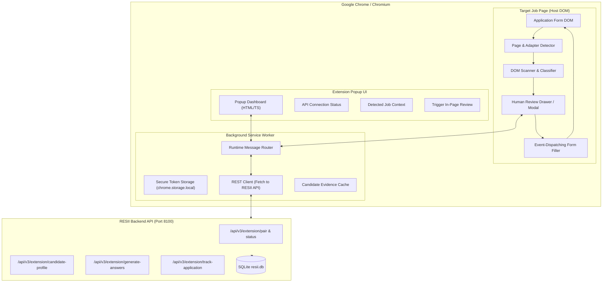

# RESII — PHASE 6F ARCHITECTURE & TECHNICAL SPECIFICATION
## Chrome Manifest V3 Browser Extension & Human-Supervised Application Autofill

**Product:** RESII — AI Career Platform  
**Target Browser:** Google Chrome / Chromium (Manifest V3)  
**API Backend:** FastAPI (`http://127.0.0.1:8100`)  
**Frontend Platform:** React + Vite + TypeScript (`http://127.0.0.1:5173`)  
**Database:** SQLite (`data/resii.db`) in WAL Mode  
**Security Boundary:** Human-Supervised Autofill — Zero Autonomous Submissions  

---

## 1. System Overview & Core Philosophy

The RESII Browser Extension bridges candidate intelligence from the RESII desktop/cloud platform directly into third-party job application portals (Greenhouse, Lever, Workday, LinkedIn, and generic career pages).

### Core Invariants:
1. **Human-in-the-Loop Supervision:** The extension identifies form fields, classifies their semantic intent, retrieves verified candidate data, and presents a structured review interface. **The user must explicitly approve proposed values. The extension NEVER submits an application autonomously.**
2. **Strict Evidence Provenance:** Every proposed field value is tagged with its evidence source:
   - `[Verified Profile]`: From user account profile (`api/account.py`).
   - `[Candidate Fact]`: From candidate facts store (`api/auto_apply.py`).
   - `[Resume Data]`: Extracted from parsed resume document tree (`api/resumes.py`).
   - `[AI Grounded]`: Generated response grounded strictly in verified candidate facts.
   - `[User Input Required]`: Unverified, subjective, or sensitive questions (demographics, EEO, disability, salary negotiations).
3. **Zero Hallucination / Zero Fabrication:** If candidate evidence does not contain verified data for a field, the extension leaves it empty and flags it for user input.
4. **Security & Privacy Isolation:** Content scripts run in an isolated world, preventing host page scripts from tampering with extension internals or extracting session secrets.

---

## 2. Chrome Manifest V3 Architecture

Chrome Manifest V3 enforces background service workers rather than persistent background pages, declarative permissions, and strict Content Security Policies.

---

## 3. Component Breakdown

### 3.1 Background Service Worker (`extension/src/background/`)
- **Lifecycle:** Event-driven worker managing extension state, token storage, and backend API communication.
- **Security Role:** Isolates API credentials and tokens from content scripts. The web page DOM cannot inspect `chrome.storage.local` or read RESII session tokens.
- **Responsibilities:**
  - Token pairing and verification with `http://127.0.0.1:8100`.
  - Caching candidate profile facts and active resume metadata.
  - Proxying AI answer generation requests from the content script to the backend.
  - Recording completed submissions to `POST /api/v3/extension/track-application`.

### 3.2 Content Scripts & Adapters (`extension/src/content/`)
Content scripts run in the context of the job application page:
- **Adapter Registry:**
  - `GreenhouseAdapter`: Specialized for Greenhouse job applications (`boards.greenhouse.io`, embedded iframes).
  - `LeverAdapter`: Specialized for Lever job postings (`jobs.lever.co`).
  - `WorkdayAdapter`: Specialized for Workday candidate portals (`*.myworkdayjobs.com`).
  - `GenericFormAdapter`: Heuristic fallback scanning any standard HTML form.
- **DOM Scanner & Field Classifier:**
  - Analyzes input, textarea, select, and file inputs.
  - Inspects `name`, `id`, `placeholder`, `aria-label`, `<label>` text, ancestor headings, and autocomplete attributes.
  - Maps elements to standard taxonomy: `first_name`, `last_name`, `full_name`, `email`, `phone`, `location`, `linkedin_url`, `github_url`, `portfolio_url`, `resume_file`, `cover_letter`, `years_experience`, `work_authorization`, `sponsorship`, `notice_period`, `salary_expectation`, `screening_question`, `sensitive_demographic`.
- **Review Drawer / Modal:**
  - Injected directly into the page as an accessible, clean overlay.
  - Surfaces detected job title, company name, and all classified fields.
  - Displays proposed value, confidence score (0–100%), and provenance badge.
  - Provides per-field checkboxes to approve or reject.
  - Allows inline editing of any proposed value before insertion.
  - Selects which tailored resume variant to attach.
- **Safe Form Filler:**
  - Injects values only into approved fields.
  - Dispatches native DOM events (`input`, `change`, `blur`) to satisfy React/Vue/Angular controlled components.
  - **Hardcoded Block on Submission:** Contains explicit safeguard rules prohibiting dispatching click events to elements matching submit buttons (`button[type="submit"]`, `input[type="submit"]`, text containing "Submit Application", "Apply Now", "Send Application").

### 3.3 Extension Popup (`extension/src/popup/`)
- Accessible from the Chrome toolbar icon.
- Displays connection health to RESII backend (`http://127.0.0.1:8100`).
- Shows current active tab job detection status (Company, Title, Portal).
- Quick actions: "Review & Autofill", "Track Application in RESII", "Pair with RESII".

---

## 4. Field Taxonomy & Evidence Provenance Specification

| Field Taxonomy Key | Evidence Source | Provenance Label | Fallback Behavior if Missing |
| :--- | :--- | :--- | :--- |
| `first_name` | UserProfile / CandidateFacts | `[Verified Profile]` | Split `name` or Leave Empty |
| `last_name` | UserProfile / CandidateFacts | `[Verified Profile]` | Split `name` or Leave Empty |
| `full_name` | UserProfile.name | `[Verified Profile]` | Concatenate First/Last |
| `email` | UserProfile.email | `[Verified Profile]` | Leave Empty |
| `phone` | UserProfile.phone | `[Verified Profile]` | Flag for User Input |
| `location` | UserProfile.location | `[Verified Profile]` | Flag for User Input |
| `linkedin_url` | CandidateFacts.linkedin_url | `[Candidate Fact]` | Flag for User Input |
| `github_url` | CandidateFacts.github_url | `[Candidate Fact]` | Flag for User Input |
| `portfolio_url` | CandidateFacts.portfolio_url | `[Candidate Fact]` | Flag for User Input |
| `work_authorization` | CandidateFacts.work_authorization | `[Candidate Fact]` | Flag for User Input |
| `requires_sponsorship`| CandidateFacts.requires_sponsorship | `[Candidate Fact]` | Flag for User Input |
| `years_experience` | CandidateFacts.years_of_experience | `[Candidate Fact]` | Flag for User Input |
| `highest_education` | CandidateFacts.highest_education | `[Candidate Fact]` | Flag for User Input |
| `notice_period` | CandidateFacts.notice_period | `[Candidate Fact]` | Flag for User Input |
| `resume_file` | Active User Resume (PDF/DOCX) | `[Resume Binary]` | Select Resume in UI |
| `screening_question` | Generated from CandidateFacts | `[AI Grounded]` | Draft for User Review |
| `sensitive_demographic`| Non-actionable | `[User Input Required]` | **NEVER AUTOFILL** |

---

## 5. Security & Isolation Architecture

1. **Host-Page Script Isolation:** Content scripts execute in an isolated JavaScript execution context. Even if a target webpage contains malicious third-party scripts, they cannot access extension APIs (`chrome.storage`, `chrome.runtime`).
2. **Cross-Origin API Token Protection:** The extension communicates with RESII API using an extension pairing token (`Bearer resii_ext_...`) stored securely in `chrome.storage.local`. The webpage cannot read this token.
3. **Prompt Injection Mitigation:** Custom screening questions extracted from the DOM are treated as untrusted text. The backend grounding engine uses structured schema extraction and bounds reasoning strictly to verified candidate facts.
4. **Anti-Automation Compliance:** The extension functions strictly as an interactive assistive tool ("digital clipboard with semantic matching"). It does not bypass CAPTCHAs, does not solve puzzles, and does not execute automated submission loops.
