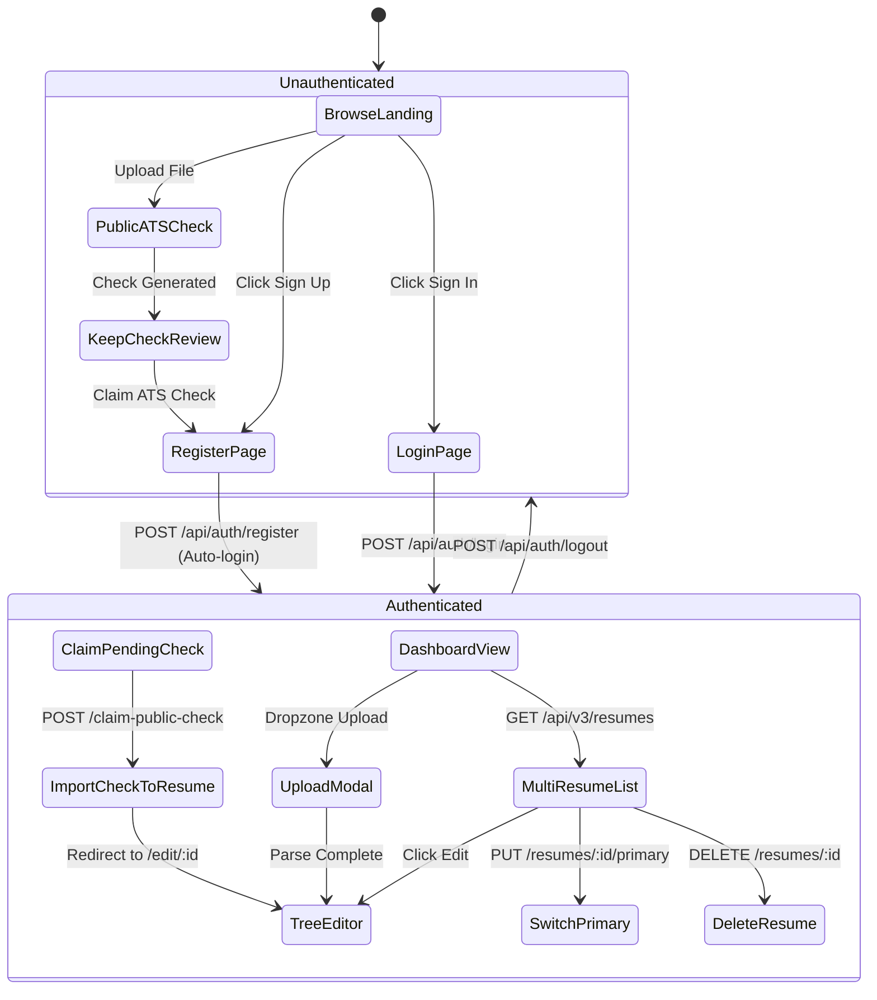

# RESII — PHASE 6H.0: ONBOARDING WORKFLOW & MULTI-RESUME MANAGEMENT SPECIFICATION

**Project:** RESII AI Career Platform (`E:\SUMED_DATA\Rezifi`)  
**Phase:** 6H.0 — Architecture & Workflow Specification  
**Status:** FROZEN SPECIFICATION  
**Target Milestone:** Phase 6H  
**Date:** 2026-11-21  

---

## 1. PURPOSE & USER JOURNEYS

Phase 6H resolves the primary product bottleneck: "Demo Lockout".  
It enables real candidates to sign up with their own credentials, upload real resumes, manage multiple resumes (primary profile vs tailored job copies), claim public ATS checks, and edit documents in the Tree Editor without being forced into the hardcoded Alex Rivera demo persona.

The implementation comprises three seamless user journeys:

```
[Journey A: Cold Registration & Direct Upload]
Landing Page -> Sign Up (/register) -> Welcome / Dropzone -> Tree Editor -> Dashboard

[Journey B: Public ATS Check Claiming]
Marketing Landing -> Free ATS Scanner -> Keep Check (/keep-check/:id) -> Sign Up / Login -> Direct Resume Import -> Tree Editor

[Journey C: Multi-Resume Management & Job Tailoring]
Dashboard -> Upload Second Resume / Tailor to Job -> Set as Primary OR Keep as Tailored Copy -> Export / Apply
```

---

## 2. WORKFLOW A: REGISTRATION & DIRECT ONBOARDING

### 2.1 Frontend User Interface & Routes
- **Route:** `/register`
- **Component:** `web/src/pages/RegisterPage.tsx`
- **Fields:**
  - Full Name (`name: string`)
  - Email Address (`email: string`)
  - Password (`password: string`, minimum 8 characters)
  - Confirm Password (client-side validation matching `password`)
- **Action Elements:**
  - "Create Account" button (disabled during submission or if client validation fails)
  - Link to `/login` ("Already have an account? Sign in")
  - Optional: "Continue with Demo Account" (in development mode only, respecting `RESII_DEMO_MODE`)

### 2.2 Execution Flow
1. User enters name, email, and password.
2. Form submits to `POST /api/auth/register`.
3. Backend:
   - Validates email syntax and password length ($\ge 8$).
   - Verifies email uniqueness in SQLite `users` table.
   - Hashes password using Argon2id (`api.security.hash_password`).
   - Inserts `UserModel(id=usr_..., email=..., name=..., password_hash=...)`.
   - Generates session ID `sess_<secrets.token_urlsafe(32)>`.
   - Sets HttpOnly signed `resii_session` cookie and readable `resii_csrf` cookie via `_set_auth_cookies()`.
   - Returns HTTP 201 with `AuthResponse`.
4. Frontend:
   - Updates Redux auth state (`user: AuthResponse.user`, `status: 'authenticated'`).
   - Redirects user to `/onboarding/upload` (or directly to `/dashboard` with an upload prompt).

---

## 3. WORKFLOW B: PUBLIC ATS CHECK CLAIMING & ONBOARDING

### 3.1 Problem Identified in Phase 6G / 6H.0 Audit
Currently, `web/src/pages/KeepCheckPage.tsx` dispatches `loginDemo()`. This discards the user's uploaded check and locks them into `usr_demo_101`.

### 3.2 Target Claiming Flow
1. Anonymous user uploads resume on public scanner; check saved with ID `chk_<hex10>`.
2. User is redirected to `/keep-check/:checkId`.
3. User reviews findings and clicks "Claim & Open in Tree Editor".
4. Frontend state check:
   - **Case 1: User is already logged in:**
     - Sends `POST /api/v3/resumes/claim-public-check` with `{ check_id: checkId }` and `X-CSRF-Token`.
     - Backend imports check into a new `ResumeModel` owned by `user.id`.
     - User is navigated directly to `/edit/:newResumeId`.
   - **Case 2: User is unauthenticated:**
     - Redirects user to `/register?claim_check=:checkId` (or `/login?claim_check=:checkId`).
     - Upon registration/login completion, the claiming thunk is triggered with the pending `checkId`.
     - Upon success, redirects to `/edit/:newResumeId`.

### 3.3 Security Invariants
- A check can only be claimed **once**. Repeated attempts return HTTP 409 Conflict.
- The claimed resume is strictly bound to `user.id`.

---

## 4. WORKFLOW C: DYNAMIC MULTI-RESUME MANAGEMENT

### 4.1 UI Overhaul for `DashboardPage.tsx`
Currently, `DashboardPage.tsx` uses hardcoded mock state (`Alex Rivera`, `rez_stripe_01`, etc.).  
In Phase 6H, it becomes dynamic, backed by `GET /api/v3/resumes`:

```
+--------------------------------------------------------------------------+
| RESII Dashboard                              Welcome back, [User Name]   |
+--------------------------------------------------------------------------+
|                                                                          |
|  [ + Upload Resume ]   [ + Tailor to Job ]   [ + New Blank Resume ]      |
|                                                                          |
|  +--------------------------------+  +--------------------------------+  |
|  | PRIMARY RESUME                 |  | TAILORED COPIES & VARIANTS     |  |
|  | Title: Staff Systems Engineer  |  |                                |  |
|  | ATS Score: 92                  |  | 1. Stripe - Backend (94%)      |  |
|  | Last Updated: 2026-11-21       |  | 2. Google - SRE (88%)          |  |
|  | Version: v3                    |  | 3. Vercel - Fullstack (91%)    |  |
|  |                                |  |                                |  |
|  | [Open Editor] [PDF] [Word]     |  | [Make Primary] [Edit] [Delete] |  |
|  +--------------------------------+  +--------------------------------+  |
|                                                                          |
|  +--------------------------------------------------------------------+  |
|  | DRAG & DROP RESUME UPLOAD ZONE (PDF, DOCX, TXT - max 10MB)         |  |
|  +--------------------------------------------------------------------+  |
+--------------------------------------------------------------------------+
```

### 4.2 Primary vs Secondary Resume Semantics
- Exactly **one** resume per candidate has `is_primary = True`.
- If a user uploads their first resume, it automatically receives `is_primary = True`.
- Clicking "Make Primary" on any other resume calls `PUT /api/v3/resumes/:id/primary`:
  - Backend executes single atomic update: resets all candidate resumes to `is_primary = False`, then sets target to `is_primary = True`.
  - Browser extension autofill will always pull verified candidate facts from the user's primary resume.

### 4.3 Resume Deletion Semantics
- Clicking "Delete" displays a confirmation modal.
- On confirm, calls `DELETE /api/v3/resumes/:id`.
- Backend verifies ownership, cleans up associated raw files via `storage_manager.delete_file()`, and removes the resume record.
- If deleted resume was primary and other resumes remain, the most recently updated resume is automatically promoted to primary.

---

## 5. DRAG-AND-DROP UPLOAD DROPZONE COMPONENT

### 5.1 Component Specification (`web/src/components/ResumeDropzone.tsx`)
- Drag-and-drop target accepting `.pdf`, `.docx`, `.txt`.
- Client-side size guard: checks `file.size <= 10 * 1024 * 1024` (10MB).
- Upload status states: `idle`, `dragging`, `uploading (progress %)`, `parsing`, `success`, `error`.
- Security Headers: Retrieves `resii_csrf` cookie and attaches `X-CSRF-Token` header.
- Endpoint: `POST /api/v3/resumes/upload`.
- On completion: Dispatches refresh of resumes list and redirects to `/edit/:id` or displays newly parsed resume in dashboard.

---

## 6. COMPLETE STATE MACHINE



---

## 7. BOUNDARY & ARCHITECTURAL INVARIANTS

1. **Strict User Isolation:** A user can never read, modify, set as primary, or delete another user's resume (`user_id == current_user.id` enforced on every query).
2. **No Data Deletion on Migration:** Existing demo data and synthetic test candidate profiles must be preserved.
3. **Cookie Security:** HttpOnly, Lax/Strict SameSite cookies for all sessions; readable CSRF token.
4. **Zero Regressions:** Existing 163 Pytest + 20 Node tests must pass at 100%.
