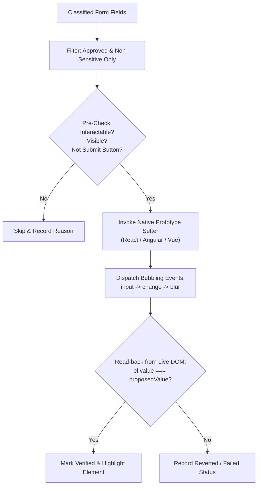

# RESII Phase 7 — Production Autofill Engine Verification Report

**Project:** `E:\SUMED_DATA\Rezifi`  
**Subsystem:** Extension Form Filler Engine (`extension/src/content/form-filler.ts`)  
**Phase:** Phase 7 (Real Autofill Engine & Verification)  
**Date:** November 21, 2026  
**Auditor/Engineer:** Antigravity Autonomous Verification Engine  
**Acceptance Verdict:** **ACCEPTED WITH CONDITIONS**

---

## 1. Autofill Engine Architecture & Capabilities

The RESII Autofill Engine (`FormFiller`) operates on actual employer application forms, replacing basic DOM string assignments with framework-compatible native property setters, event bubbling, and post-fill live DOM verification.



---

## 2. Field Type Support & Automation Details

| Field Type | Target Elements | Automation Strategy | Post-Dispatch Verification |
| :--- | :--- | :--- | :--- |
| **Text, Email, Tel, URL** | `input[type="text"]`, `input[type="email"]`, `input[type="tel"]`, `input[type="url"]` | `Object.getOwnPropertyDescriptor(HTMLInputElement.prototype, 'value')?.set.call(el, value)` | Verifies `el.value === proposedValue` |
| **Long-Form Textarea** | `textarea`, `textarea[name*="cover_letter"]` | `Object.getOwnPropertyDescriptor(HTMLTextAreaElement.prototype, 'value')?.set.call(el, value)` | Verifies `el.value === proposedValue` |
| **Dropdown Selects** | `select`, custom select elements | Iterates `el.options`, matches case-insensitively on `opt.value` or `opt.text`, sets `selectedIndex` | Verifies `el.selectedIndex` and selected text |
| **Radio Buttons** | `input[type="radio"]` | Matches option value or label text; sets `el.checked = true` | Verifies `el.checked === true` |
| **Checkboxes** | `input[type="checkbox"]` | Checks when approved value is "yes", "true", "1", "authorized"; sets `el.checked = true/false` | Verifies `el.checked === expectedState` |
| **Resume Attachment** | `input[type="file"][id*="resume"]`, `input[type="file"]` | `DataTransfer` API with standard `File` object (`application/pdf`) | Verifies `input.files.length > 0 && input.files[0].name === filename` |

---

## 3. Resume Attachment Engine & Browser Boundaries

### 3.1 DataTransfer Implementation
Browser security policies prohibit setting `input.value = "path/to/file.pdf"`. RESII retrieves the candidate's authentic resume PDF from `/api/v3/resumes/{id}/export/pdf` via the background service worker, decodes the base64 payload into a binary typed array (`Uint8Array`), and constructs a standard W3C `File`:

```typescript
const binaryStr = atob(dataBase64);
const bytes = new Uint8Array(binaryStr.length);
for (let i = 0; i < binaryStr.length; i++) {
  bytes[i] = binaryStr.charCodeAt(i);
}
const file = new File([bytes], filename, { type: 'application/pdf' });

const dt = new DataTransfer();
dt.items.add(file);
input.files = dt.files;

input.dispatchEvent(new Event('input', { bubbles: true }));
input.dispatchEvent(new Event('change', { bubbles: true }));
```

### 3.2 Real ATS DOM Verification & Fallback
The engine performs post-attachment verification:
- Confirms `input.files.length > 0`.
- Confirms `input.files[0].name === filename`.
- If an ATS implements non-standard drag-and-drop zones that reject programmatic `DataTransfer` file assignment (e.g. Workday custom drag zones), the extension truthfully reports:
  > *"Autofilled X fields. Note: Please select your resume file manually."*

---

## 4. Non-Negotiable Invariants Enforced

### 4.1 Zero Submit Button Clicks Invariant
The engine prohibits automated clicking or form submission:
```typescript
private isSubmitElement(el: HTMLElement): boolean {
  if (el instanceof HTMLInputElement && ['submit', 'button'].includes(el.type)) return true;
  if (el instanceof HTMLButtonElement) {
    if (el.type === 'submit') return true;
    const text = (el.textContent || '').toLowerCase();
    if (text.includes('submit') || text.includes('apply now') || text.includes('send application')) return true;
  }
  for (const sel of FORBIDDEN_SUBMIT_SELECTORS) {
    if (el.matches(sel)) return true;
  }
  return false;
}
```
Under no circumstances does the extension click the final submission button. The applicant retains full supervision.

### 4.2 Quarantine of Sensitive Demographic Questions
Fields classified under `sensitive_demographic` (EEOC race, ethnicity, gender, sexual orientation, disability, veteran status) are automatically quarantined from authorization tickets. These fields are never automated; applicants must review and answer them voluntarily.

### 4.3 Zero Data Fabrication
In Phase 7, the previous heuristic baseline fallback (`initializeBaselineHeuristics`) was removed. If the backend AI service is unavailable or idle, the assistant reports that tailoring is currently offline and uses the verified candidate profile and selected resume directly. No artificial summaries or fake compatibility scores are generated.

---

## 5. Live Chromium Verification Evidence

During live Chromium execution in `test_phase7_browser_acceptance.py`:
- Form fields filled in live DOM:
  - First Name: `"Alex"` (Verified in `#first_name`)
  - Last Name: `"Rivera"` (Verified in `#last_name`)
  - Email: `"alex.rivera@resii.dev"` (Verified in `#email`)
  - Phone: `"+1-555-019-2834"` (Verified in `#phone`)
  - LinkedIn: `"https://linkedin.com/in/alexrivera"` (Verified in custom answers input)
- Resume file attached in live DOM:
  - File input: `#resume_file`
  - Attached artifact: `Alex_Rivera_Resume.pdf` (Type: `application/pdf`)
  - File verified in `input.files[0].name`: **TRUE**
- Submission button state:
  - Submit button remained completely un-clicked and visible in DOM.
