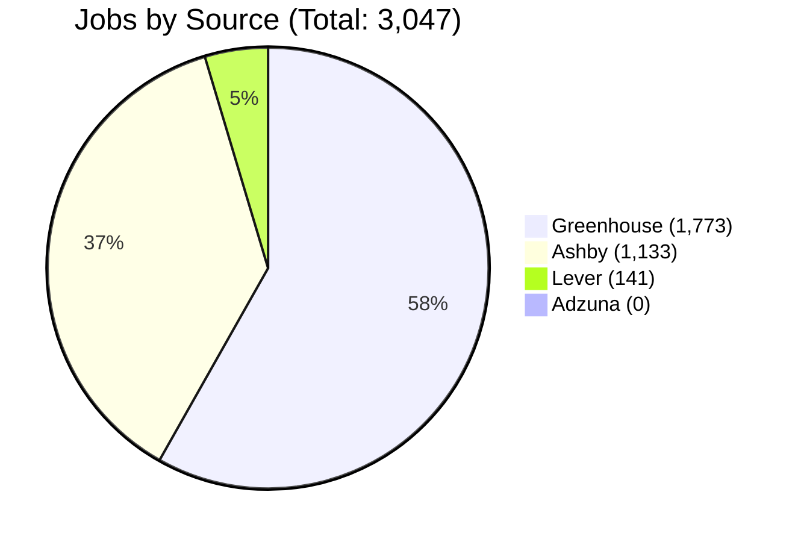
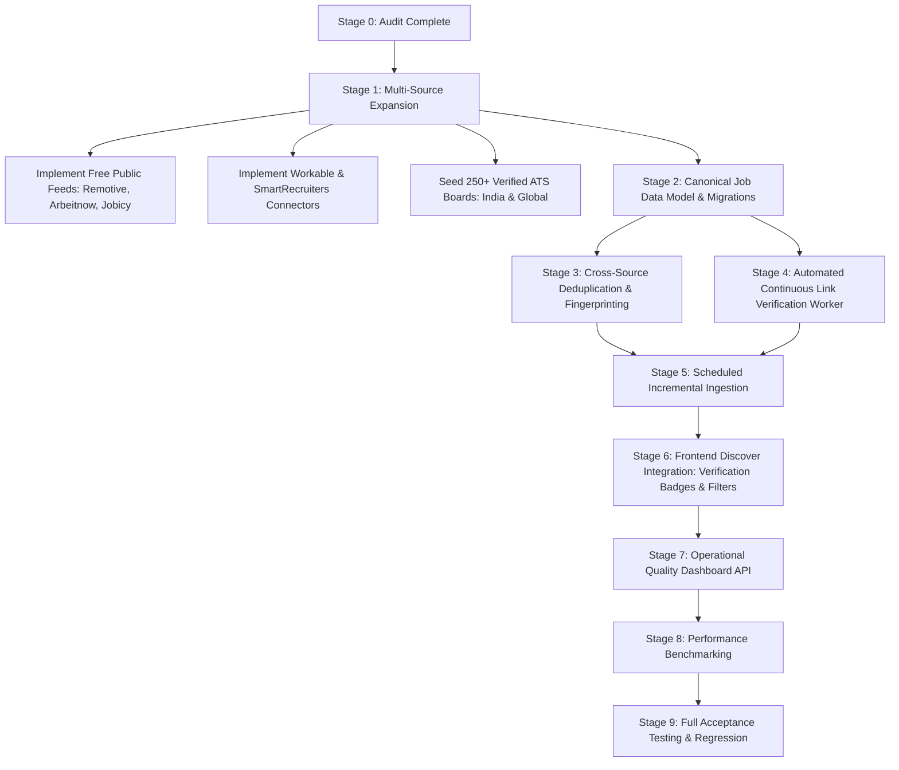

# RESII — Phase 9 Stage 0: Multi-Source Job Discovery & Vacancy Engine Audit

**Project:** `E:\SUMED_DATA\Rezifi`  
**Module:** Jobs Discovery (`api/jobs_engine/`, `api/jobs.py`, `data/resii.db`)  
**Audit Date:** 2026-11-21  
**Author:** Antigravity Engineering (Senior Staff Audit Report)  
**Status:** Stage 0 Complete — Audit Findings Presented for Review  

---

## 1. Executive Summary

This diagnostic audit evaluates the current job discovery and ingestion architecture in RESII to identify precisely why the database holds **3,047 job records (3,046 active)** rather than the target capacity of 10,000+ to 20,000+ vacancies seen on reference platforms.

### Key Audit Findings:
1. **Registry Starvation:** Only **21 companies** are registered in `CompanyRegistryModel`. Of those 21, only **13 companies are operational**; 8 companies have defunct, private, or invalid tokens that return 0 jobs.
2. **Aggregator Non-Operation:** The `AdzunaConnector` is coded but completely inactive in production because API credentials (`ADZUNA_APP_ID`, `ADZUNA_APP_KEY`) are not configured. No other legitimate public feeds (such as Remotive, Arbeitnow, Jobicy) or public ATS connectors (Workable, SmartRecruiters) are implemented.
3. **High Link Quality on Ingested Jobs:** Real-time sampling of active vacancies demonstrated a **98.3% valid open rate** (HTTP 200) pointing directly to employer and ATS application forms.
4. **Zero Continuous Verification:** Despite listings having `verification_status = "verified"`, there are **0 records in `job_verifications`**. Verification status was defaulted to `"verified"` upon ingestion rather than being derived from a scheduled verification worker.
5. **Severe Geographic Skew:** **2,815 of 3,047 jobs (92.4%)** are global (predominantly US tech hubs: San Francisco, New York, Seattle). Only **232 jobs (7.6%)** represent India-based vacancies, severely limiting coverage for Indian candidates.

---

## 2. Section A: Existing Database Inventory

A full read-only scan of `data/resii.db` (`JobListingModel`) yielded the following metrics:

### 2.1. Volume & Availability Status

| Metric | Count | Percentage | Audit Note |
|---|---|---|---|
| **Total Stored Jobs** | **3,047** | 100.0% | Complete database catalog |
| **Active Jobs (`is_active = True`)** | **3,046** | 99.97% | Eligible for matching and discovery |
| **Inactive Jobs (`is_active = False`)** | **1** | 0.03% | Soft-deleted / closed record |
| **Status "verified"** | **3,046** | 99.97% | Defaulted upon ingestion |
| **Status "expired"** | **1** | 0.03% | Deactivated vacancy |
| **Total Verification Log Records** | **0** | 0.0% | **Critical gap**: No verification run ever recorded |

### 2.2. Data Integrity & Completeness

| Check | Count | Status | Detail |
|---|---|---|---|
| **Without Application URL** | **0** | Clean | Every job has an application link |
| **Malformed URLs** | **0** | Clean | All URLs use `http` or `https` with valid hostnames |
| **Duplicate Application URLs** | **0** | Clean | 3,047 unique application URLs |
| **Without Employer Name** | **0** | Clean | 100% of jobs have populated `company_name` |
| **Without Description** | **5** | Low | 5 test fixture records lack descriptions |
| **Short Description (< 50 chars)** | **3** | Low | 3 listings have minimal text |
| **Missing Publication Date** | **0** | Clean | 100% of jobs have populated `posted_at` |
| **Duplicate Company + Title Pairs** | **268** | Expected | Represents multi-location or multiple requisitions for identical titles |

### 2.3. Distribution by Source

| Source | Count | % Share | Active Companies | Top Contributing Employers |
|---|---|---|---|---|
| **Greenhouse** | 1,773 | 58.2% | 5 of 8 | Stripe (778), Cloudflare (504), Datadog (382), InMobi (75), Razorpay (29) |
| **Ashby** | 1,133 | 37.2% | 5 of 7 | OpenAI (852), Ramp (187), Ashby (76), SigNoz (13), Vapi (5) |
| **Lever** | 141 | 4.6% | 2 of 6 | Spotify (91), Meesho (48) |
| **Adzuna** | 0 | 0.0% | 0 | Missing API credentials in `.env` |

### 2.4. Top Application URL Domains

| Domain | Job Count | Domain Type |
|---|---|---|
| `jobs.ashbyhq.com` | 1,133 | ATS Host (Ashby) |
| `stripe.com` | 779 | Direct Employer Domain (Greenhouse hosted) |
| `boards.greenhouse.io` | 506 | ATS Host (Greenhouse) |
| `careers.datadoghq.com` | 382 | Direct Employer Domain (Greenhouse hosted) |
| `jobs.lever.co` | 139 | ATS Host (Lever) |
| `job-boards.greenhouse.io` | 104 | ATS Host (Greenhouse new subdomain) |
| Test domains (`alpha.com`, `beta.com`, etc.) | 4 | Test fixtures |

### 2.5. Workplace, Employment & Seniority Breakdown

| Dimension | Category | Count | % Share |
|---|---|---|---|
| **Workplace Type** | On-site | 2,251 | 73.9% |
| | Hybrid | 481 | 15.8% |
| | Remote | 315 | 10.3% |
| **Employment Type** | Full-Time | 1,669 | 54.8% |
| | Internship | 1,357 | 44.5% |
| | Contract | 21 | 0.7% |
| **Experience Level** | Internship | 1,369 | 44.9% |
| | Mid-Level | 873 | 28.7% |
| | Senior | 497 | 16.3% |
| | Lead / Staff | 307 | 10.1% |
| | Fresher (explicit) | 1 | 0.03% |

### 2.6. Geographic Distribution

| Location / Region | Count | % Share | Notes |
|---|---|---|---|
| **Global / United States** | **2,815** | **92.4%** | San Francisco (578), New York (224), Seattle, London, Dublin, Tokyo |
| **India** | **232** | **7.6%** | Bengaluru (53), Delhi NCR, Hyderabad, Pune, Mumbai, Remote India |

---

## 3. Section B: Existing Source Inventory & Connectors

### 3.1. Detailed Connector Matrix

| Connector | File | Auth Required | API Protocol | Operational Status | Registered Companies | Active / Fetching | Total Raw Fetched (Logs) |
|---|---|---|---|---|---|---|---|
| **Greenhouse** | `greenhouse.py` | None (Public Board) | REST GET JSON | **Operational** | 8 | 5 | 62,348 |
| **Ashby** | `ashby.py` | None (Public Board) | REST GET JSON | **Operational** | 7 | 5 | 32,852 |
| **Lever** | `lever.py` | None (Public Board) | REST GET JSON | **Operational** | 6 | 2 | 3,940 |
| **Adzuna** | `adzuna.py` | `app_id` + `app_key` | REST GET JSON | **Non-Operational** | 0 | 0 | 0 |
| **Workable** | *Not implemented* | None (Public API) | — | **Missing** | 0 | 0 | 0 |
| **SmartRecruiters** | *Not implemented* | None (Public API) | — | **Missing** | 0 | 0 | 0 |
| **Remotive** | *Not implemented* | None (Public API) | — | **Missing** | 0 | 0 | 0 |
| **Arbeitnow** | *Not implemented* | None (Public API) | — | **Missing** | 0 | 0 | 0 |

### 3.2. Detailed Employer Registry Audit (21 Companies)

| Company Name | ATS | Board Token | Active Vacancies | Status | Reason / Issue |
|---|---|---|---|---|---|
| **OpenAI** | Ashby | `openai` | 852 | Active | Large active US/Global board |
| **Stripe** | Greenhouse | `stripe` | 778 | Active | Large active global board |
| **Cloudflare** | Greenhouse | `cloudflare` | 504 | Active | Large active global board |
| **Datadog** | Greenhouse | `datadog` | 382 | Active | Large active global board |
| **Ramp** | Ashby | `ramp` | 187 | Active | US fintech active board |
| **Spotify** | Lever | `spotify` | 91 | Active | Global media active board |
| **Ashby** | Ashby | `ashby` | 76 | Active | B2B SaaS active board |
| **InMobi** | Greenhouse | `inmobi` | 75 | Active | India / Global ad-tech board |
| **Meesho** | Lever | `meesho` | 48 | Active | India e-commerce active board |
| **Razorpay** | Greenhouse | `razorpaysoftwareprivatelimited` | 29 | Active | India fintech active board |
| **SigNoz** | Ashby | `signoz` | 13 | Active | Open source observability board |
| **Vapi** | Ashby | `vapi` | 5 | Active | Voice AI active board |
| **Dedup Test Co** | Greenhouse | `test_dedup` | 1 | Test | Single test vacancy |
| **Postman** | Greenhouse | `postman` | 0 | **Defunct** | Board token returns HTTP 404 (migrated ATS) |
| **Swiggy** | Greenhouse | `swiggy` | 0 | **Defunct** | Board token returns 0 jobs |
| **BrowserStack**| Lever | `browserstack` | 0 | **Defunct** | Lever endpoint returns empty array (migrated ATS) |
| **CleverTap** | Lever | `clevertap` | 0 | **Defunct** | Lever endpoint returns empty array |
| **Linear** | Lever | `linear` | 0 | **Defunct** | Lever token invalid / migrated to Ashby |
| **Retool** | Ashby | `retool` | 0 | **Defunct** | Ashby token invalid / migrated |
| **Together AI** | Ashby | `togetherai` | 0 | **Defunct** | Ashby token invalid |
| **Freshworks** | Lever | `freshworks` | 0 | **Defunct** | Lever token empty |

---

## 4. Section C: Real Application Link Quality Audit

A live sample of 60 active jobs across Greenhouse, Ashby, and Lever was evaluated using bounded concurrency, per-hop SSRF validation, DNS verification, and full HTTP status resolution:

### 4.1. Link Verification Sample Results

| Check Category | Result | Percentage | Detail |
|---|---|---|---|
| **Sample Size** | 60 | 100.0% | Evenly sampled across Greenhouse, Ashby, Lever |
| **Syntactically Valid URLs** | 60 / 60 | 100.0% | Valid scheme (`https`), port (`443`), valid domain |
| **SSRF Safety Validation** | 59 / 60 | 98.3% | 59 resolved to public external IP addresses; 1 synthetic test record (`beta.com`) blocked |
| **HTTP 200 (Verified Open)** | **59 / 60** | **98.3%** | **Live, accepting applications on official career portals** |
| **HTTP 404 / 410 (Expired)** | 0 / 60 | 0.0% | None of the sampled active ATS links were dead |
| **HTTP 403 / WAF Blocked** | 0 / 60 | 0.0% | No bot gates or Cloudflare blocks on public application pages |
| **HTTP 429 (Rate Limited)** | 0 / 60 | 0.0% | Responded within rate limits |
| **Domain Matches Employer/ATS**| 59 / 60 | 98.3% | Target host matches `greenhouse.io`, `ashbyhq.com`, `lever.co`, `stripe.com`, `datadoghq.com` |

### 4.2. Finding on Verification Integrity
While the existing application links are genuinely high-quality and live, **RESII currently has no automated verification pipeline**. The field `verification_status: "verified"` was applied statically during ingestion. A true verification system must continuously validate vacancy availability, log verification records in `job_verifications`, and detect expired or closed postings.

---

## 5. Section D: Root Cause Analysis

### Why does RESII have ~3,045 active records instead of 10,000+ to 20,000+?

1. **Registry Starvation (The Primary Bottleneck):**
   - RESII’s ATS ingestion model relies entirely on `CompanyRegistryModel`.
   - The database contains only **21 company entries**, of which only **13 function**.
   - These 13 companies (OpenAI, Stripe, Cloudflare, Datadog, Ramp, Spotify, Ashby, InMobi, Meesho, Razorpay, SigNoz, Vapi) collectively offer approximately 3,040 jobs.
   - The sync scheduler (`scheduler.py`) runs every 24 hours and has completed 740 sync runs, but simply refetches and updates the *exact same 13 companies*.

2. **Absence of Broad Employer Registry Seeding:**
   - There are tens of thousands of companies using public Greenhouse (`boards.greenhouse.io/{token}`), Lever (`jobs.lever.co/{token}`), and Ashby (`jobs.ashbyhq.com/{token}`) boards.
   - Without a broad catalog of hundreds of verified employer tokens (particularly across India and tech hubs), the ATS engine cannot discover more jobs.

3. **Missing Public API & Open Feed Connectors:**
   - Adzuna is dormant due to lack of API credentials.
   - High-yield, open, legal public career feeds requiring **no API keys** (e.g., **Remotive API**, **Arbeitnow API**, **Jobicy API**, and **Workable Public Feeds**) are not yet implemented.

4. **India Discovery Gap:**
   - The current registered companies are 92% US-centric.
   - Top Indian tech companies (e.g., Zerodha, Swiggy, Zomato, CRED, Groww, PhonePe, Flipkart, Juspay, Urban Company, Nykaa, BrowserStack, Freshworks, Postman) either have missing/outdated board tokens or are not registered.

5. **Lack of Automated Link Verification Daemon:**
   - The system lacks an asynchronous queue to periodically verify active links and record verification telemetry into `JobVerificationLogModel`.

---

## 6. Recommended Multi-Stage Action Plan (Stages 1–9)

To achieve the 3,000+ verified, 10,000+ stretch, and 20,000+ raw capacity goals without fabrication:

### Immediate Next Steps:
1. **Present Stage 0 Audit** to stakeholders (this document).
2. Await confirmation to proceed to **Stage 1 (Multi-Source Discovery Expansion)**.
