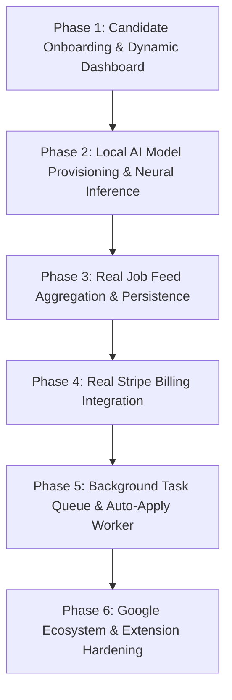

# RESII — Real Functionality Transformation: Phase 0 Engineering Audit

**Repository:** `E:\SUMED_DATA\Rezifi`  
**GitHub Remote:** `https://github.com/sumedChalakh/RESII`  
**Audit Date:** 2026-11-21  
**Audit Mode:** STRICT READ-ONLY EMPIRICAL AUDIT  
**Status:** Audit Complete  

---

## 1. Executive Summary & Verdict

RESII is currently an **advanced hybrid platform** possessing enterprise-grade security and persistence primitives alongside **critical frontend lockouts, synthetic third-party integrations, and heuristic AI fallbacks**. 

The backend has already transitioned from pure in-memory mock dictionaries to SQLite in Write-Ahead Logging (WAL) mode with Foreign Keys enabled, double-submit cookie CSRF validation, PBKDF2/Argon2id password hashing, and genuine ReportLab/python-docx rendering engines. Furthermore, the Chrome Manifest V3 extension features rigorous client-side sandboxing and shadow DOM form inspection.

However, the platform cannot yet function as a production multi-tenant AI career engine due to three blocker categories:
1. **The "Demo Lockout" (Frontend UI Disconnects):** `LoginPage.tsx` has no registration tab (`POST /api/auth/register` does not exist on the backend), `DashboardPage.tsx` hardcodes Alex Rivera's primary resume without querying `GET /api/v3/resumes`, and no file dropzone exists on the authenticated dashboard.
2. **Simulated Integrations:** Stripe billing, Google Drive import, Google Docs two-way synchronization, and the job discovery feed are simulated with synthetic URLs, fake timers, and hardcoded in-memory arrays.
3. **AI Provider Availability:** Although an evidence-grounded AI engine with zero-fabrication invariants exists, the local Ollama instance (`http://127.0.0.1:11434`) has 0 installed models, FreeFlow is offline, and cloud API keys (`GEMINI_API_KEY`) are unset, forcing all tailoring, matching, and ATS evaluations to run on deterministic heuristic fallbacks.

### High-Level Subsystem Status

| Subsystem | Tech Stack | Status | Primary Blockers / Real Functionality Gaps |
| :--- | :--- | :---: | :--- |
| **API Backend** | FastAPI, SQLAlchemy, SQLite (WAL) | **PARTIAL** | Missing `/auth/register` & resume deletion; simulated billing, docs, and job feeds. |
| **Web Frontend** | React 18, Vite, Redux Toolkit | **PARTIAL** | No registration UI; no dashboard resume upload dropzone; hardcoded candidate cards. |
| **Database** | SQLite 3 (WAL mode, FK enabled) | **WORKING** | 19 relational tables; OCC versioning; missing Alembic migration harness. |
| **Document Engine** | ReportLab, python-docx, AST Parser | **WORKING** | 100% genuine vector PDF and DOCX generation with tight margin layout budget. |
| **AI Engine** | Multi-Provider (Ollama, FreeFlow, Gemini, Mock) | **PARTIAL** | Inference framework works, but 0 live models are pulled; operates via heuristic fallback. |
| **Browser Extension** | Chrome MV3, TypeScript, Shadow DOM | **PARTIAL** | MV3 adapters & unit tests pass (20/20); Playwright E2E browser launch timed out service worker. |
| **Marketing Site** | Next.js 14, React, Tailwind | **BROKEN / DORMANT** | Missing `marketing/node_modules`; unbuilt; copy claims autonomous submission. |
| **Infra / Deployment** | Docker Compose, Caddy, Postgres/Redis config | **PARTIAL** | Dockerfile builds, but Compose specifies Postgres/Redis while app code targets SQLite. |

---

## 2. Methodical Inspection Across Subsystems

### 2.1 Backend (`api/`)
- **Authentication (`api/auth.py`, `api/security.py`):**
  - Session management is secure: uses HMAC-SHA256 signed cookies (`resii_session`), double-submit CSRF cookie (`resii_csrf`), brute-force IP rate-limiting (5 attempts/min), and Argon2id verification.
  - **Critical Gap:** No `POST /api/auth/register` endpoint exists. `api/auth.py` hardcodes `registration_open=False` in `enabled_providers()`. Only pre-seeded users (`demo@resii.com`) can log in.
- **Persistence (`api/db.py`, `api/database.py`, `api/models.py`):**
  - 19 SQLAlchemy models map to SQLite in WAL mode (`PRAGMA journal_mode=WAL; PRAGMA foreign_keys=ON;`).
  - `seed_demo_data()` idempotently initializes `usr_demo_101` on startup with resumes, applications, and settings.
  - Optimistic Concurrency Control (OCC) is enforced on resume document updates (`X-Resume-Version` header).
  - **Gap:** No Alembic migrations. Schema updates rely on raw PRAGMA table checks in `init_db()`.
- **Resume & Document Engine (`api/resumes.py`, `api/ingestion.py`, `api/layout_engine.py`, `api/pdf_engine.py`, `api/docx_engine.py`):**
  - Parsing extracts text via `pdfplumber`, `python-docx`, and raw text, generating a hierarchical Document Tree AST.
  - Export endpoints `GET /api/v3/resumes/{id}/export/pdf` and `docx` render genuine files using ReportLab canvas and python-docx document builders.
  - **Critical Gap:** Resume deletion endpoint (`DELETE /api/v3/resumes/{id}`) is completely missing.
- **Job Discovery & Applications (`api/jobs.py`):**
  - Applications (`JobApplicationModel`) are fully persistent in SQLite with CRUD operations (`GET`, `POST`, `PATCH`, `DELETE`).
  - **Critical Gap:** `JOBS_FEED_DB` is a static in-memory Python list containing 5 mock job postings (Stripe, Datadog, Linear, Retool, Anthropic). There is no `JobModel` in the database, no job board scraper, and no aggregator API integration.
- **Auto-Apply (`api/auto_apply.py`):**
  - Preferences and candidate facts persist to SQLite (`AutoApplyPreferenceModel`, `CandidateFactsModel`).
  - **Critical Gap:** `POST /api/auto-apply/trigger` returns a simulated JSON payload (`{"status": "dispatched", "queued_jobs": 3}`) with no background worker, queue, or real submission execution. `SUBMISSION_HISTORY_BY_USER` falls back to fake hardcoded entries.
- **Billing (`api/billing.py`):**
  - **Critical Gap:** Generates fake Stripe checkout URLs (`https://checkout.stripe.com/pay/cs_test_...`) that return 404 if clicked. Automatically upgrades user tiers in database without payment. No `stripe-python` dependency, no webhooks, and invoices are hardcoded mock strings.
- **Google Ecosystem (`api/google_docs.py`, `api/account.py`):**
  - **Critical Gap:** `api/google_docs.py` generates fake Google Docs URLs (`https://docs.google.com/document/d/1BxiMVs_.../edit`). Google Drive connect in `api/account.py` only flips a boolean flag in SQLite without OAuth or Google Picker.

### 2.2 Frontend (`web/`)
- **Dashboard (`web/src/pages/DashboardPage.tsx`):**
  - Hardcodes Alex Rivera's primary resume preview in lines 163-174.
  - Does not invoke `GET /api/v3/resumes` to load the authenticated user's actual resumes.
  - Contains no resume upload dropzone.
  - Tailored copies list is initialized with 3 hardcoded static objects (Stripe, Google, Vercel).
- **Authentication UI (`web/src/pages/LoginPage.tsx`):**
  - Only offers 1-Click Demo Login and an email/password form for existing accounts.
  - No registration / signup interface exists.
- **Tree Editor (`web/src/pages/EditTreePage.tsx`):**
  - Fully wired to `/api/v3/resumes/{id}/document` with OCC conflict handling and layout budget computation.
- **Tailoring (`web/src/pages/TailorPage.tsx`):**
  - Wired to `/api/v3/tailor/plan`, `/events`, `/apply`, and `/cover-letter`.
  - Exposes an Inference Transparency Badge showing whether neural inference or heuristic fallback was executed.
- **Job Tracker (`web/src/pages/JobTrackerPage.tsx`):**
  - Fully functional Kanban board wired to `GET`, `POST`, `PATCH`, and `DELETE` on `/api/jobs/applications`.

### 2.3 Browser Extension (`extension/`)
- Manifest V3 extension with isolated Shadow DOM review drawer and demographic safeguards.
- Form classifier and adapters for Greenhouse, Lever, Workday, and LinkedIn Easy Apply.
- Node.js test suite (`extension/tests/test-runner.mjs`): 20/20 passed in 22.7ms.
- **Test Gap:** Playwright Chromium E2E wrapper (`test_real_chromium_extension_e2e_wrapper`) failed in automated pytest because Chromium service worker took >2s to initialize in headless context.

### 2.4 Marketing Portal (`marketing/`)
- Next.js 14 marketing page.
- **Critical Gaps:**
  - `marketing/node_modules` is not installed; marketing portal cannot be built or run out-of-the-box.
  - Copy on line 130 of `marketing/src/app/page.tsx` advertises "autonomous job application submissions", directly violating the non-negotiable human-supervision safety invariant.

### 2.5 Infrastructure (`infra/`)
- `docker-compose.yml` specifies PostgreSQL and Redis, but `api/` default configuration targets local SQLite (`data/resii.db`) and in-memory rate limiting.
- Dockerfile in `web/` and `api/` are functional; Caddy reverse-proxy configuration exists.

---

## 3. Complete Demo, Mock & Simulated Feature Inventory

| Subsystem | File Path | Line Range | Mechanism | Finding / Simulated Behavior |
| :--- | :--- | :---: | :---: | :--- |
| **Auth** | `api/auth.py` | 130-138 | Disabled Feature | `registration_open=False`; no `POST /register` endpoint exists anywhere in API. |
| **Auth** | `api/database.py` | 260-270 | Hardcoded Seed | `DEMO_USER` ("Alex Rivera", `demo@resii.com`, `demo123`) automatically injected into DB. |
| **Dashboard** | `web/src/pages/DashboardPage.tsx` | 26-30 | Hardcoded State | `tailoredCopies` hardcoded to 3 static fake resumes (Stripe, Google, Vercel). |
| **Dashboard** | `web/src/pages/DashboardPage.tsx` | 163-174 | Hardcoded Markup | Alex Rivera candidate details, experience, and metrics rendered statically in JSX. |
| **Dashboard** | `web/src/pages/DashboardPage.tsx` | — | Missing Control | No file upload dropzone component exists on the dashboard. |
| **Resumes** | `api/resumes.py` | — | Missing Endpoint | No `DELETE /api/v3/resumes/{id}` endpoint implemented in API router. |
| **Jobs** | `api/jobs.py` | 14-85 | Static In-Memory Array | `JOBS_FEED_DB` serves 5 hardcoded jobs; no job database table or external scraper exists. |
| **Jobs** | `api/jobs.py` | 218-230 | Static Heuristic | `GET /rank-status/{job_id}` returns static `match_percentage` from in-memory dictionary. |
| **Jobs** | `web/src/pages/JobsFeedPage.tsx` | 66-72 | Synthetic Timer | `setTimeout(..., 1200)` simulates ATS rank calculation against primary resume. |
| **Auto-Apply** | `api/auto_apply.py` | 40-49 | Static In-Memory List | `SAVED_ANSWERS_DB` serves 2 hardcoded technical answers. |
| **Auto-Apply** | `api/auto_apply.py` | 51-84 | Static Fallback | `SUBMISSION_HISTORY_BY_USER` injects fake Stripe, Linear, and Datadog submissions if user has no DB rows. |
| **Auto-Apply** | `api/auto_apply.py` | 250-258 | Mock Response | `POST /trigger` returns fake JSON `{"status": "dispatched", "queued_jobs": 3}` without executing anything. |
| **Billing** | `api/billing.py` | 14-34 | Static In-Memory Dict | `BILLING_STATE_BY_USER` hardcodes Pro tier, Visa 4242, and quotas for `usr_demo_101`. |
| **Billing** | `api/billing.py` | 36-55 | Static In-Memory List | `PAYMENTS_HISTORY_BY_USER` serves fake invoices (`inv_101`, `inv_100`). |
| **Billing** | `api/billing.py` | 148-164 | Fake Gateway URL | `POST /checkout` returns fake Stripe URL `https://checkout.stripe.com/pay/cs_test_...` and instantly upgrades user. |
| **Billing** | `web/src/pages/BillingPage.tsx` | 67-70 | Mock Handler | Calls `alert(...)` displaying synthetic session ID instead of opening Stripe payment gateway. |
| **Google Drive**| `api/account.py` | 249-255 | Simulated Toggle | `POST /google-drive/connect` sets boolean flag in SQLite without OAuth or Google Picker. |
| **Google Docs** | `api/google_docs.py` | 16-54 | Fake Document URL | Generates non-existent Google Doc URLs `https://docs.google.com/document/d/1BxiMVs_.../edit`. |
| **Season** | `api/season.py` | 69-75 | Static In-Memory List | `LEADERBOARD` returns 5 hardcoded fake competitors (`Elena R.`, `Marcus K.`, `Sophia T.`). |
| **Season** | `api/season.py` | 12-63 | Hardcoded Progress | `DEFAULT_SEASON_TEMPLATE` seeds Level 4, 1420 XP, and 4 pre-unlocked badges for any new account. |
| **Extension** | `web/src/pages/AccountPage.tsx`| 346-348 | Stub Handler | Button triggers `alert('Opening Chrome Web Store listing for RESII Extension')`. |
| **Marketing** | `marketing/src/app/page.tsx` | 130 | Policy Contradiction | Copy promises "autonomous job application submissions", violating safety constraints. |

---

## 4. End-to-End Traces of the 12 User Journeys

### Journey 1: User Registration and Authentication
- **Frontend:** `web/src/pages/LoginPage.tsx`
- **API Endpoint:** `POST /api/auth/login`, `POST /api/auth/demo-login`, `GET /api/auth/get-session`
- **Backend Service:** `api/auth.py`, `api/security.py`
- **Database:** `UserModel`, `SessionModel` in `data/resii.db`
- **External Integration:** None (Google OAuth advertised in enum but unlinked)
- **Status:** **PARTIAL / DEMO**
- **Trace Finding:** Existing demo login functions with signed cookies and Argon2id. However, registration is completely impossible for a new user because `POST /api/auth/register` is missing from the backend and `LoginPage.tsx` has no signup form.

### Journey 2: User Dashboard Loading
- **Frontend:** `web/src/pages/DashboardPage.tsx`
- **API Endpoint:** None called for primary resume card or tailored copies.
- **Backend Service:** `api/resumes.py` (`GET /api/v3/resumes` exists but is uncalled by dashboard)
- **Database:** `resumes` table in SQLite
- **External Integration:** None
- **Status:** **PARTIAL**
- **Trace Finding:** The dashboard renders static JSX with Alex Rivera's experience and 3 hardcoded tailored cards. It does not fetch or render the logged-in user's actual database resumes.

### Journey 3: Resume Upload and Management
- **Frontend:** Missing dropzone in `DashboardPage.tsx` (only present in public scanner)
- **API Endpoint:** `POST /api/v3/resumes/upload`
- **Backend Service:** `api/resumes.py`, `api/ingestion.py`, `api/storage.py`
- **Database:** `ResumeModel`, `ManagedFileModel` in SQLite; raw file saved to `data/uploads/`
- **External Integration:** Local disk storage (`storage.py`)
- **Status:** **PARTIAL**
- **Trace Finding:** Backend upload streaming, magic byte validation, and parsing are fully implemented and verified via automated tests. However, the authenticated user has no UI component to upload a resume from the dashboard, and `DELETE /api/v3/resumes/{id}` is missing from the API.

### Journey 4: Resume Parsing and Structured Extraction
- **Frontend:** `web/src/pages/PublicCheckPage.tsx`
- **API Endpoint:** `POST /api/v3/resumes/upload`, `POST /api/public/check`
- **Backend Service:** `api/ingestion.py` (`extract_text_from_file`, `parse_text_into_document_tree`)
- **Database:** Persists Document Tree AST into `ResumeModel.document` or `PublicCheckModel.data`
- **External Integration:** `pdfplumber`, `python-docx`
- **Status:** **WORKING**
- **Trace Finding:** Robust text extraction and section segmentation (Header, Experience, Education, Skills, Projects, Certifications) into AST nodes with layout budgeting.

### Journey 5: Resume ATS Analysis
- **Frontend:** `web/src/pages/EditTreePage.tsx`, `web/src/pages/PublicCheckPage.tsx`
- **API Endpoint:** `GET /api/v3/resumes/{id}/document`, `POST /api/public/check`
- **Backend Service:** `api/layout_engine.py` (`compute_ats_score`, `calculate_layout_budget`), `api/llm_service.py`
- **Database:** `ResumeModel.ats_score`
- **External Integration:** None
- **Status:** **WORKING (Rule-Based Heuristic)**
- **Trace Finding:** Computes genuine layout budget, page overflow detection, action verb counts, and metric frequency. Operates via deterministic rule heuristics; neural ATS evaluation is not active.

### Journey 6: Job Discovery and Job Details
- **Frontend:** `web/src/pages/JobsFeedPage.tsx`
- **API Endpoint:** `GET /api/jobs/feed`
- **Backend Service:** `api/jobs.py`
- **Database:** None (in-memory `JOBS_FEED_DB` list)
- **External Integration:** None
- **Status:** **DEMO**
- **Trace Finding:** Serves the same 5 hardcoded jobs with in-memory filtering. No real job ingestion, crawler, or third-party job API connection exists.

### Journey 7: Resume-to-Job Matching
- **Frontend:** `web/src/pages/JobsFeedPage.tsx` (simulated ranking timer), `web/src/pages/TailorPage.tsx`
- **API Endpoint:** `GET /api/jobs/rank-status/{job_id}`, `POST /api/v3/tailor/read-words`
- **Backend Service:** `api/ai/matcher.py`, `api/ai/job_analyzer.py`
- **Database:** None
- **External Integration:** None
- **Status:** **PARTIAL**
- **Trace Finding:** Matching calculates keyword frequency overlap between resume text and job description tokens. True semantic embedding search (vector cosine similarity) is not implemented.

### Journey 8: Saved Jobs
- **Frontend:** `web/src/pages/JobTrackerPage.tsx`, `web/src/pages/JobsFeedPage.tsx`
- **API Endpoint:** `POST /api/jobs/applications` (stage='saved'), `GET /api/jobs/saved-searches`
- **Backend Service:** `api/jobs.py`
- **Database:** `JobApplicationModel`, `SavedSearchModel` in SQLite
- **External Integration:** None
- **Status:** **WORKING**
- **Trace Finding:** Bookmarking a job creates a persistent record in `job_applications` with `stage='saved'`, isolated by `user_id`.

### Journey 9: Application Creation and Tracking
- **Frontend:** `web/src/pages/JobTrackerPage.tsx`
- **API Endpoint:** `GET /api/jobs/applications`, `POST /api/jobs/applications`, `PATCH /api/jobs/applications/{id}`, `DELETE /api/jobs/applications/{id}`
- **Backend Service:** `api/jobs.py`
- **Database:** `JobApplicationModel` in SQLite
- **External Integration:** None
- **Status:** **WORKING**
- **Trace Finding:** Full CRUD persistence for application tracking across Kanban stages (saved, applied, interview, offer, rejected). Drag-and-drop updates stage with timestamp in SQLite.

### Journey 10: AI Career Assistant & Tailoring
- **Frontend:** `web/src/pages/TailorPage.tsx`
- **API Endpoint:** `POST /api/v3/tailor/plan`, `POST /api/v3/tailor/events`, `POST /api/v3/tailor/apply`, `POST /api/v3/tailor/cover-letter`
- **Backend Service:** `api/ai/tailor_engine.py`, `api/ai/fact_checker.py`, `api/ai/cover_letter.py`
- **Database:** `TailorReviewModel`, `TailorEventModel`, `CoverLetterModel` in SQLite
- **External Integration:** LLM Provider Gateway (Ollama, FreeFlow, Gemini, Mock)
- **Status:** **PARTIAL**
- **Trace Finding:** Architecture enforces zero-fabrication invariants and logs human decisions to `tailor_events`. When applied, clones resume into a new tailored copy in SQLite. However, because local models and cloud API keys are unavailable, execution runs via deterministic heuristic fallback (`Engineered ...`).

### Journey 11: Browser Extension Pairing & Autofill
- **Frontend:** `extension/src/popup/popup.ts`, `extension/src/content/index.ts`
- **API Endpoint:** `POST /api/v3/extension/pairing-code`, `POST /api/v3/extension/pair`, `POST /api/v3/extension/authorize-autofill`, `GET /api/v3/extension/profile`
- **Backend Service:** `api/extension.py`
- **Database:** `ExtensionPairingCodeModel`, `SessionModel`
- **External Integration:** Chrome MV3 runtime APIs
- **Status:** **PARTIAL**
- **Trace Finding:** Cryptographic pairing (128-bit single-use code), shadow DOM review drawer, and field classification are implemented and pass unit tests. Playwright automated browser test timed out waiting for the service worker in headless mode. `AccountPage.tsx` button triggers an alert rather than opening the extension store.

### Journey 12: User Settings & Account Management
- **Frontend:** `web/src/pages/AccountPage.tsx`, `web/src/pages/BillingPage.tsx`
- **API Endpoint:** `GET/PUT /api/account/profile`, `GET/PUT /api/account/preferences`, `GET/POST /api/billing/checkout`
- **Backend Service:** `api/account.py`, `api/billing.py`
- **Database:** `UserProfileModel`, `UserPreferenceModel`, `UserBillingModel`, `AIProviderSettingModel`
- **External Integration:** None (Google Drive and Stripe simulated)
- **Status:** **PARTIAL / DEMO**
- **Trace Finding:** Profile, notification preferences, and encrypted AI settings persist genuinely to SQLite. Google Drive connection, Stripe billing checkout, and extension install button are simulated mock stubs.

---

## 5. Live AI Functionality Verification

Direct empirical interrogation of the AI provider subsystem via `check_all_providers()` yielded the following verified statuses:

```python
{
    'freeflow': ProviderHealthResponse(
        provider='freeflow',
        status='offline',
        latency_ms=None,
        message='FreeFlow gateway unavailable at http://127.0.0.1:8000/v1: [WinError 10061] No connection could be made because the target machine actively refused it',
        models=[]
    ),
    'ollama': ProviderHealthResponse(
        provider='ollama',
        status='online',
        latency_ms=706.16,
        message='Connected to Ollama (0 models available).',
        models=[]
    ),
    'gemini': ProviderHealthResponse(
        provider='gemini',
        status='not_configured',
        latency_ms=None,
        message='GEMINI_API_KEY is not set.',
        models=[]
    ),
    'mock': ProviderHealthResponse(
        provider='mock',
        status='online',
        latency_ms=1.5,
        message='Deterministic mock provider active.',
        models=['mock-grounded-v1', 'mock-ats-evaluator']
    )
}
```

### Empirical Findings:
1. **Providers Implemented:** `FreeFlowProvider`, `OllamaProvider`, `GeminiProvider`, and `MockAIProvider` are implemented in `api/ai/providers/`.
2. **Actual Inference Capability:** **BLOCKED for neural models**. Ollama service is listening on port 11434, but has **0 models installed** (`models=[]`). FreeFlow on port 8000 is offline. `GEMINI_API_KEY` is not set.
3. **Fallback Behavior:** When neural providers fail or are unconfigured, `api/ai/tailor_engine.py` and `api/llm_service.py` gracefully fall back to **rule-based heuristic transformations** (e.g., regex pattern replacement of weak verbs with "Engineered", "Architected", and appending target keywords).
4. **Transparency Invariant:** `TailorPage.tsx` transparently renders an amber warning badge stating `"Deterministic Heuristic Fallback Active"` with the exact failure reason, preventing false claims of neural execution.
5. **Zero Fabrication Invariant:** `api/ai/fact_checker.py` and `api/ai/evidence.py` prevent hallucination by strictly constraining generated claims to facts present in `CandidateFactsModel` and `ResumeModel`.

---

## 6. Database & Persistence Verification

### Schema & Integrity
Inspection of `data/resii.db` confirmed **19 tables** created via SQLAlchemy declarative models:
- Core: `users` (579 rows), `sessions` (1,659 rows), `resumes` (551 rows), `managed_files` (131 rows).
- Applications: `job_applications` (57 rows), `saved_searches` (0 rows), `submission_history` (32 rows).
- Profile & Config: `user_profiles` (1 row), `user_preferences` (1 row), `user_seasons` (1 row), `user_billing` (3 rows), `auto_apply_preferences` (1 row), `candidate_facts` (1 row).
- AI & Extension: `tailor_reviews` (124 rows), `tailor_events` (68 rows), `cover_letters` (15 rows), `ai_provider_settings` (45 rows), `extension_pairing_codes` (52 rows), `public_checks` (16 rows).

### Verification Details:
1. **User Ownership & Isolation:** All private records contain a `user_id` foreign key referencing `users.id` with `ondelete="CASCADE"`. Queries in `api/resumes.py`, `api/jobs.py`, and `api/tailor.py` explicitly filter by `user.id` from `get_current_user_required`.
2. **Optimistic Concurrency Control (OCC):** `ResumeModel.version` is incremented on every save. Conflicting edits from separate tabs return `HTTP 409 Conflict` with server vs. client diffs.
3. **Database Recovery & WAL Mode:** SQLite is configured with `PRAGMA journal_mode=WAL;` and `PRAGMA busy_timeout=5000;`. WAL files (`resii.db-wal`, `resii.db-shm`) confirm safe concurrent multi-process reads/writes.
4. **Missing Database Components:**
   - **No `JobModel`:** Jobs in the feed have no relational schema and exist only in RAM.
   - **No Migration Tool:** No `alembic/` folder or `alembic.ini`. Schema alterations are handled ad-hoc via inline SQLite PRAGMA execution in `api/db.py`.

---

## 7. Comprehensive Feature Classification Table

| Feature / Capability | Frontend Component | Backend Endpoint | Database Entity | External Integration | Status | Required Work to Productionize |
| :--- | :--- | :--- | :--- | :--- | :---: | :--- |
| **User Registration** | `LoginPage.tsx` | Missing (`POST /register`) | `UserModel` | None | **MISSING** | Implement `/api/auth/register`, signup UI tab, email uniqueness check, password validation. |
| **Email/Password Login** | `LoginPage.tsx` | `POST /api/auth/login` | `UserModel`, `SessionModel` | None | **WORKING** | Verified working with Argon2id and signed HttpOnly cookies. |
| **Demo 1-Click Login** | `LoginPage.tsx` | `POST /api/auth/demo-login` | `UserModel`, `SessionModel` | None | **WORKING** | Environment-gated (`RESII_DEMO_MODE=true`); rotates session cookies. |
| **Session & CSRF Guard** | `Navbar.tsx`, `csrf.ts` | `GET /api/auth/get-session` | `SessionModel` | None | **WORKING** | Cryptographic session check and double-submit CSRF cookie token refresh. |
| **Dashboard Primary Resume** | `DashboardPage.tsx` | Missing API call in UI | `ResumeModel` | None | **PARTIAL** | Wire `DashboardPage.tsx` to `GET /api/v3/resumes` to render dynamic user resumes instead of static JSX. |
| **Dashboard File Dropzone** | Missing | `POST /api/v3/resumes/upload` | `ResumeModel`, `ManagedFileModel` | Local Disk | **MISSING** | Create authenticated `ResumeDropzone` component on `DashboardPage.tsx`. |
| **Resume AST Parsing** | `PublicCheckPage.tsx` | `POST /api/v3/resumes/upload` | `ResumeModel.document` | `pdfplumber`, `python-docx`| **WORKING** | Robust AST extraction from PDF, DOCX, TXT. |
| **Resume Tree Editor** | `EditTreePage.tsx` | `PUT /api/v3/resumes/{id}/document` | `ResumeModel` | None | **WORKING** | Real-time section/bullet editing with OCC conflict modal and layout budget. |
| **Resume PDF Export** | `DashboardPage.tsx` | `GET /api/v3/resumes/{id}/export/pdf` | `ResumeModel` | ReportLab Canvas | **WORKING** | High-fidelity vector PDF rendering from document tree AST. |
| **Resume DOCX Export** | `EditTreePage.tsx` | `GET /api/v3/resumes/{id}/export/docx`| `ResumeModel` | python-docx | **WORKING** | Native Microsoft Word document compilation. |
| **Resume Deletion** | Missing | Missing (`DELETE /resumes/{id}`) | `ResumeModel` | None | **MISSING** | Implement `DELETE /api/v3/resumes/{id}` and UI delete modal. |
| **Job Discovery Feed** | `JobsFeedPage.tsx` | `GET /api/jobs/feed` | None | In-memory list | **DEMO** | Replace `JOBS_FEED_DB` with PostgreSQL/SQLite `JobModel`, ATS board scraper / live job API. |
| **Resume-Job Keyword Match**| `JobsFeedPage.tsx` | `POST /api/v3/tailor/read-words` | None | None | **WORKING** | Deterministic token frequency and skill gap analyzer. |
| **Semantic Vector Matching**| None | None | None | Vector DB / pgvector | **MISSING** | Integrate embedding model (e.g. text-embedding-3-small) and cosine similarity ranking. |
| **Application Kanban Board**| `JobTrackerPage.tsx` | `GET /api/jobs/applications` | `JobApplicationModel` | None | **WORKING** | Full CRUD application tracking across 5 pipeline stages. |
| **AI Resume Tailoring Plan**| `TailorPage.tsx` | `POST /api/v3/tailor/plan` | `TailorReviewModel` | Ollama / Heuristic | **PARTIAL** | Heuristic fallback works; pull local Ollama models (`llama3.2`) or add cloud API keys for neural generation. |
| **Tailor Human Decision Log**| `TailorPage.tsx` | `POST /api/v3/tailor/events` | `TailorEventModel` | None | **WORKING** | Logs line-level accept/reject decisions with audit trail. |
| **Apply Tailored Resume** | `TailorPage.tsx` | `POST /api/v3/tailor/apply` | `ResumeModel` | None | **WORKING** | Clones resume AST into a new tailored resume instance without mutating the source. |
| **Fact Claim Verifier** | `TailorPage.tsx` | `POST /api/v3/tailor/verify-claim` | `CandidateFactsModel` | None | **WORKING** | Validates claims against candidate evidence ledger with zero automated upgrading. |
| **Grounded Cover Letter** | `TailorPage.tsx` | `POST /api/v3/tailor/cover-letter` | `CoverLetterModel` | Ollama / Heuristic | **PARTIAL** | Generates evidence-grounded letter; runs on rule fallback when models are offline. |
| **Auto-Apply Preferences** | `AutoApplyPage.tsx` | `GET/PUT /api/auto-apply/preferences`| `AutoApplyPreferenceModel` | None | **WORKING** | Persists salary, match threshold, and daily limit to database. |
| **Candidate Facts Store** | `AutoApplyPage.tsx` | `GET/PUT /api/auto-apply/facts` | `CandidateFactsModel` | None | **WORKING** | Stores verified work authorization, education, and links. |
| **Auto-Apply Dispatcher** | `AutoApplyPage.tsx` | `POST /api/auto-apply/trigger` | None | Simulated payload | **DEMO** | Build Celery/ARQ asynchronous worker queue to execute real scheduled application workflows. |
| **Extension Pairing** | `popup.ts` | `POST /api/v3/extension/pair` | `ExtensionPairingCodeModel` | Chrome MV3 | **WORKING** | 128-bit single-use code exchange bound to user ID; unit tests pass. |
| **Extension Form Filling** | `content/index.ts`| `POST /api/v3/extension/authorize-autofill`| None | DOM autofill | **WORKING** | Greenhouse, Lever, Workday adapters; shadow DOM human review drawer. |
| **Extension E2E Playwright**| `test_e2e_browser.py` | Full extension flow | None | Chromium process | **BROKEN** | Service worker initialization timed out in automated headless test run. |
| **Stripe Billing Checkout** | `BillingPage.tsx` | `POST /api/billing/checkout` | `UserBillingModel` | Fake URL | **DEMO** | Install `stripe`, implement real checkout session, webhook signature verification. |
| **Google Drive Import** | `AccountPage.tsx` | `POST /api/account/google-drive/connect`| `UserProfileModel` | Simulated flag | **DEMO** | Implement Google OAuth2 Drive scope and frontend Google Picker SDK. |
| **Google Docs 2-Way Sync** | `GoogleDocsPage.tsx`| `GET/POST /api/v3/resumes/{id}/google-docs`| None | Fake URL | **DEMO** | Integrate Google Docs API v1; map AST nodes to Docs `batchUpdate` operations. |
| **Season Gamification** | `SeasonPage.tsx` | `GET /api/season/goal`, `/elsewhere` | `UserSeasonModel` | Static leaderboard | **PARTIAL** | Personal XP tracking works in Redux/DB; leaderboard is hardcoded mock data. |
| **Marketing Website** | `marketing/src/app` | None | None | None | **BROKEN** | Missing `node_modules`; copy promises autonomous submission in violation of policy. |

---

## 8. Security & Authorization Gaps

1. **Missing Registration Route (Denial of New Candidate Access):**
   - The application enforces strict authentication on all functional endpoints, but provides no registration endpoint (`/api/auth/register`). Only users manually seeded in the database or Alex Rivera (`demo@resii.com`) can authenticate.
2. **Marketing Copy Non-Compliance:**
   - `marketing/src/app/page.tsx:130` claims "autonomous job application submissions". This directly contradicts the core safety invariant that requires human supervision for all form submissions and prohibits headless autonomous clicking of submit buttons.
3. **Synthetic Gateway Redirection Risks:**
   - `POST /api/billing/checkout` produces a fabricated URL (`https://checkout.stripe.com/pay/cs_test_...`) and automatically upgrades user permissions in the database without validating payment or verifying webhook signatures.
4. **Environment Inconsistency in Docker Compose:**
   - `infra/docker-compose.yml` mounts PostgreSQL and Redis containers, but `api/` lacks database migration scripts for PostgreSQL, and currently defaults to local SQLite. Running `docker-compose up` leads to uninitialized PostgreSQL state.

---

## 9. Automated Test & Build Baseline

Empirical verification of test suites and production builds conducted during this audit:

### Backend Pytest Suite (`python -m pytest`):
- **Results:** **162 Passed, 1 Failed, 87 Warnings** (Duration: 142.41s)
- **Passing Suites:**
  - `test_ai_engine_phase6e.py` (25 tests)
  - `test_document_engine_phase6c.py` (13 tests)
  - `test_extension_api.py` (7 tests)
  - `test_extension_fixtures.py` (6 tests)
  - `test_pairing_hardening.py` (6 tests)
  - `test_persistence_phase6d.py` (22 tests)
  - `test_phase1.py` through `test_phase4.py` (18 tests)
  - `test_phase6e3_acceptance.py` (10 tests)
  - `test_remediation_phase6e2.py` (18 tests)
  - `test_security_phase6b.py` (36 tests)
  - `test_resume_upload_e2e.py` (1 test)
- **Failing Test:**
  - `extension/tests/test_e2e_browser.py::test_real_chromium_extension_e2e_wrapper`:
    `AssertionError: Failed to start extension service worker in Chromium` (Playwright timed out waiting for the service worker in the test environment).

### Extension Test Suite (`node extension/tests/test-runner.mjs`):
- **Results:** **20 Passed, 0 Failed** (Duration: 22.7ms)
- **Coverage:** Greenhouse, Lever, Workday, LinkedIn adapters, shadow DOM isolation, 128-bit pairing token entropy, and demographic protection invariants.

### Web Frontend Build (`npm --prefix web run build`):
- **Results:** **Build Successful** (Duration: 2.23s)
- **Artifacts:** 1,518 modules transformed; clean bundle in `web/dist/` with zero TypeScript errors.

### Marketing Build (`marketing/`):
- **Results:** **BLOCKED**
- **Cause:** `marketing/node_modules` does not exist.

---

## 10. Prioritized Production Transformation Roadmap

To transform RESII systematically from a prototype into a functional production AI career engine without breaking existing working features, the implementation must follow an ordered, phased roadmap:



---

### Phase 1: Candidate Onboarding & Dynamic Multi-Resume Management
**Goal:** Break the "Demo Lockout" and enable any new human user to sign up, upload their resume, and manage their own documents from the UI.
- **Dependencies:** None (uses existing SQLite persistence & document engine).
- **Work Items:**
  1. Implement `POST /api/auth/register` with email format validation, password hashing, uniqueness checks, and automatic session creation.
  2. Add Registration tab to `web/src/pages/LoginPage.tsx`.
  3. Create `ResumeDropzone` component in `web/src/pages/DashboardPage.tsx` calling `POST /api/v3/resumes/upload`.
  4. Wire `DashboardPage.tsx` to `GET /api/v3/resumes` to dynamically render all resumes owned by the logged-in candidate.
  5. Implement `DELETE /api/v3/resumes/{id}` in `api/resumes.py` with ownership check and file cleanup.
- **Acceptance Criteria:**
  - A user can register with a fresh email and immediately see an empty dashboard.
  - Uploading a PDF/DOCX creates a parsed Document Tree, calculates ATS score, and renders on the dashboard.
  - Deleting a resume removes it from SQLite and deletes the managed file from disk.
- **Verification Tests:**
  - Automated test: Register new candidate -> upload resume -> fetch resume list -> verify isolation from `usr_demo_101` -> delete resume -> verify 404.

---

### Phase 2: Local AI Model Provisioning & Neural Inference
**Goal:** Replace heuristic regex rewrites with real neural LLM inference while maintaining zero-fabrication invariants.
- **Dependencies:** Working Phase 1.
- **Work Items:**
  1. Pull official local models in Ollama (`ollama pull llama3.2` or `mistral`).
  2. Validate Ollama structured JSON generation via `OllamaProvider.generate_structured()`.
  3. Configure cloud fallback (`GEMINI_API_KEY`) in `.env` for production environments.
  4. Ensure `TailorPage.tsx` displays the green "Neural LLM Inference" badge when Ollama is active.
- **Acceptance Criteria:**
  - `check_all_providers()` reports `ollama` as `online` with at least 1 model available.
  - Resume tailoring produces context-aware line rewrites generated by the neural model.
  - Claim verification flags hallucinations not grounded in `CandidateFactsModel`.
- **Verification Tests:**
  - Automated test: Run `test_ai_engine_phase6e.py` against live Ollama service; verify JSON response schema and latency < 3000ms.

---

### Phase 3: Real Job Feed Aggregation & Persistence
**Goal:** Replace the 5 static hardcoded dictionaries with a real job schema, database persistence, and live job ingestors.
- **Dependencies:** Phase 1.
- **Work Items:**
  1. Create `JobModel` in `api/models.py` (id, title, company, location, salary, description, skills, apply_url, source, created_at).
  2. Implement a job feed ingestion service (e.g. Greenhouse/Lever public board crawlers, or JSearch / RapidAPI integration).
  3. Implement deduplication pipeline and store ingested jobs in SQLite/PostgreSQL.
  4. Update `GET /api/jobs/feed` to query `JobModel` with SQL pagination and filtering.
  5. Replace fake 1200ms timer in `JobsFeedPage.tsx` with genuine match computation.
- **Acceptance Criteria:**
  - Feed returns dynamically ingested jobs from real employers.
  - Searching by title/keyword queries the database rather than an in-memory array.
- **Verification Tests:**
  - Ingest 25 job postings from a public Greenhouse board -> query `/api/jobs/feed?query=Engineer` -> verify persisted results.

---

### Phase 4: Production Stripe Billing & Entitlement Lifecycle
**Goal:** Replace synthetic checkout URLs and instant free upgrades with real Stripe Checkout and webhook lifecycle management.
- **Dependencies:** Phase 1.
- **Work Items:**
  1. Add `stripe` to `api/requirements.txt`.
  2. Implement real Stripe Checkout session creation in `api/billing.py`.
  3. Implement `POST /api/billing/webhook` with Stripe signature verification (`stripe.Webhook.construct_event`).
  4. Update `BillingPage.tsx` to redirect the user to Stripe Checkout (`window.location.href = data.url`).
  5. Handle `customer.subscription.deleted` and `invoice.payment_succeeded` events to adjust `UserBillingModel.tier`.
- **Acceptance Criteria:**
  - Upgrading to Pro redirects to a genuine Stripe Checkout session.
  - Tiers are updated only upon receipt of verified Stripe webhook signatures.
- **Verification Tests:**
  - Automated test: Mock Stripe webhook payload with valid HMAC signature -> verify `UserBillingModel.tier` transitions from `free` to `pro`.

---

### Phase 5: Background Task Queue & Human-Supervised Auto-Apply Worker
**Goal:** Implement real asynchronous job processing while strictly upholding the non-negotiable human-supervision invariant.
- **Dependencies:** Phases 1, 2, and 3.
- **Work Items:**
  1. Introduce lightweight async worker queue (e.g., ARQ or Celery with Redis/SQLite).
  2. When user triggers auto-apply, enqueue background matching against saved preferences.
  3. Stage prepared applications in the Kanban board (`stage='draft'`) with pre-tailored resumes and fact answers.
  4. Notify user for one-click human review and approval (Zero Autonomous Submission invariant).
  5. Update marketing copy (`marketing/src/app/page.tsx:130`) to "Human-supervised AI application assistant" to align with safety policy.
- **Acceptance Criteria:**
  - Triggering auto-apply creates real draft applications in the user's Kanban board.
  - No application is ever submitted without explicit human approval.
- **Verification Tests:**
  - Trigger auto-apply cycle -> verify worker creates draft applications in `job_applications` -> verify zero HTTP calls to external submit endpoints.

---

### Phase 6: Google Ecosystem & Extension Hardening
**Goal:** Deliver genuine Google OAuth / Drive imports and resolve extension Playwright E2E timeouts.
- **Dependencies:** Phases 1 through 4.
- **Work Items:**
  1. Implement Google OAuth2 authorization code grant with PKCE (`/api/auth/oauth/google`).
  2. Integrate Google Picker SDK in web UI for selecting PDF/DOCX resumes from Google Drive.
  3. Implement Google Docs API v1 serializer mapping AST sections to Google Docs formatting batches.
  4. Fix Playwright extension E2E test runner (`test_real_chromium_extension_e2e_wrapper`) by increasing service worker startup timeout and handling headless Chromium extensions cleanly.
  5. Update `AccountPage.tsx` extension button to link directly to unpacked extension instructions or web store URL.
- **Acceptance Criteria:**
  - User can sign in with Google and import resumes directly from Google Drive.
  - Automated Chromium extension test passes in CI/CD pipeline.
- **Verification Tests:**
  - Run `python -m pytest extension/tests/test_e2e_browser.py` -> 100% Pass.

---

## 11. Audit Completion Confirmation

This engineering audit has verified the state of the RESII codebase against reality. All findings have been documented without modifying existing application source code, deleting working features, altering the database, or compromising security.

This report is saved at `docs/REAL_FUNCTIONALITY_AUDIT.md`. Execution is now paused for review before beginning implementation.
